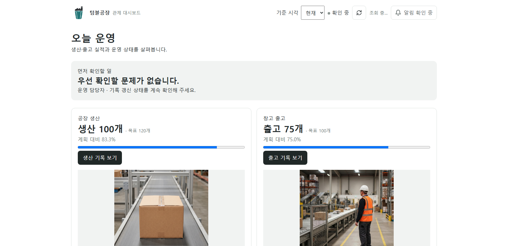
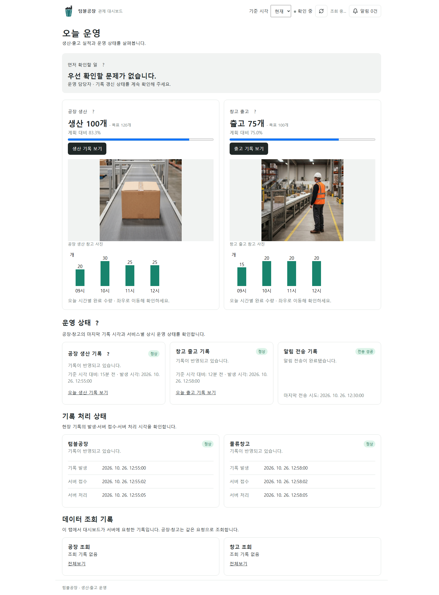
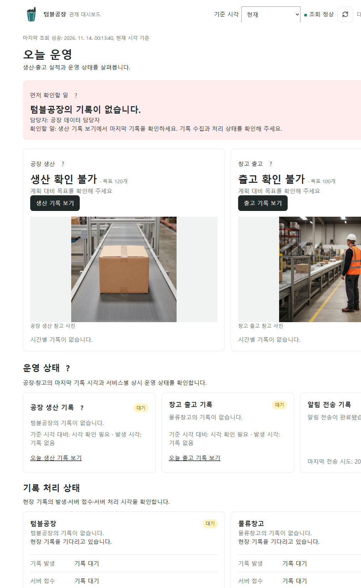
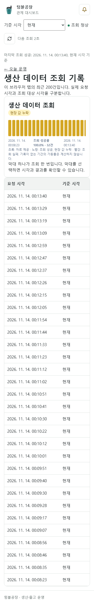
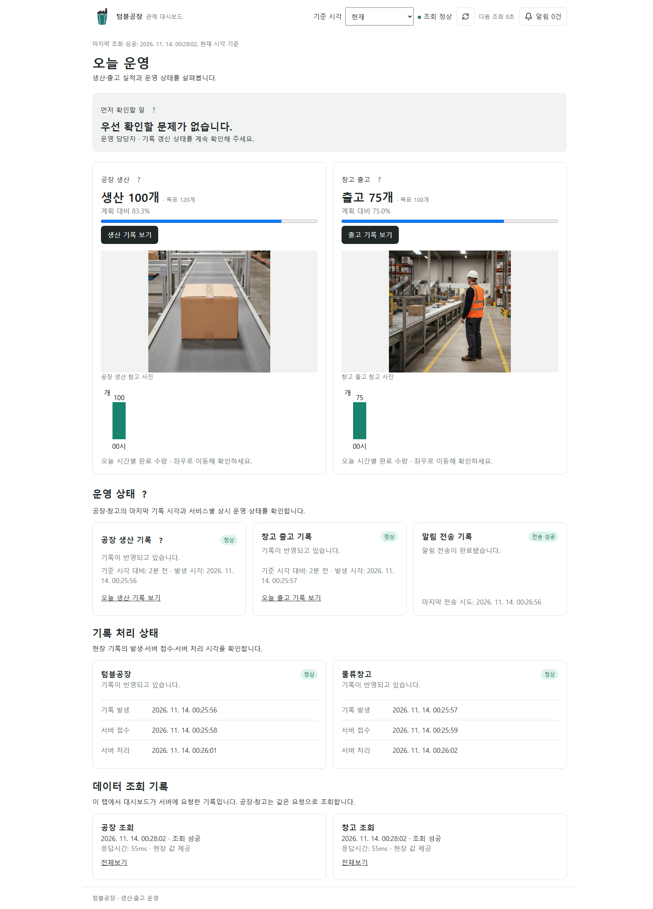
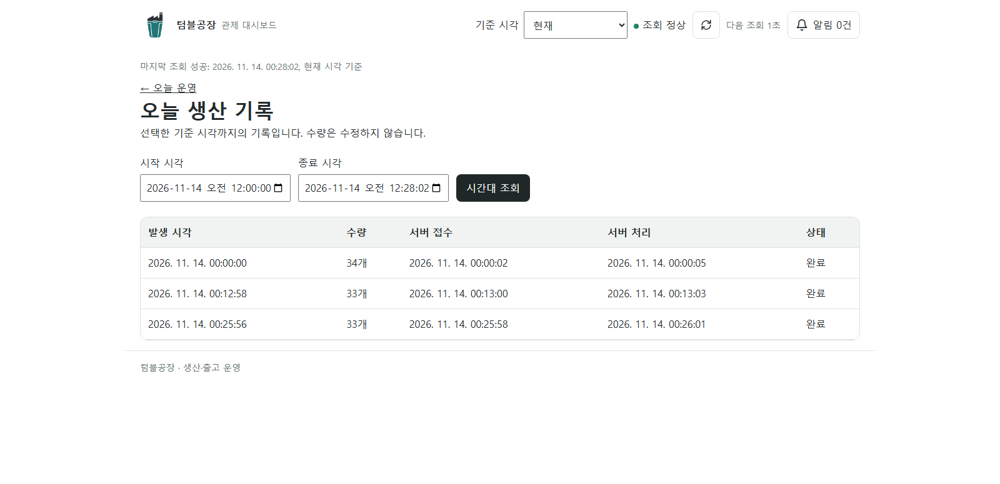
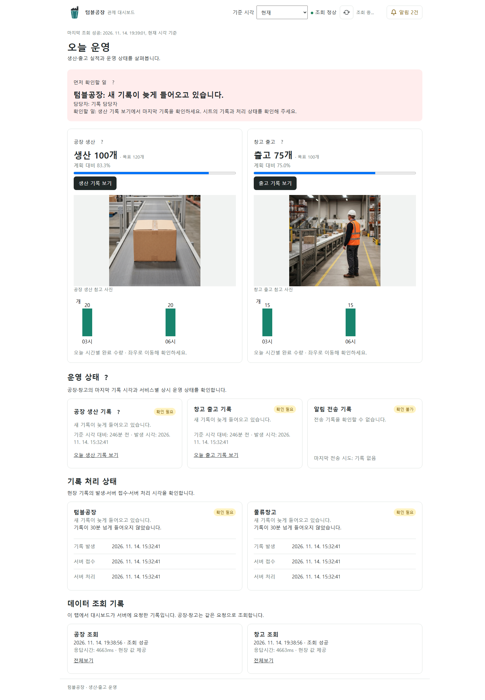
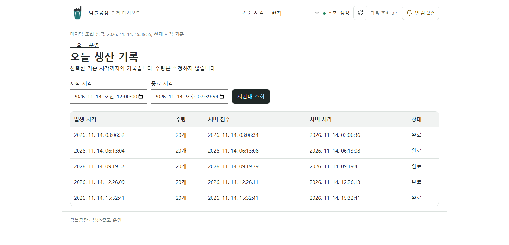
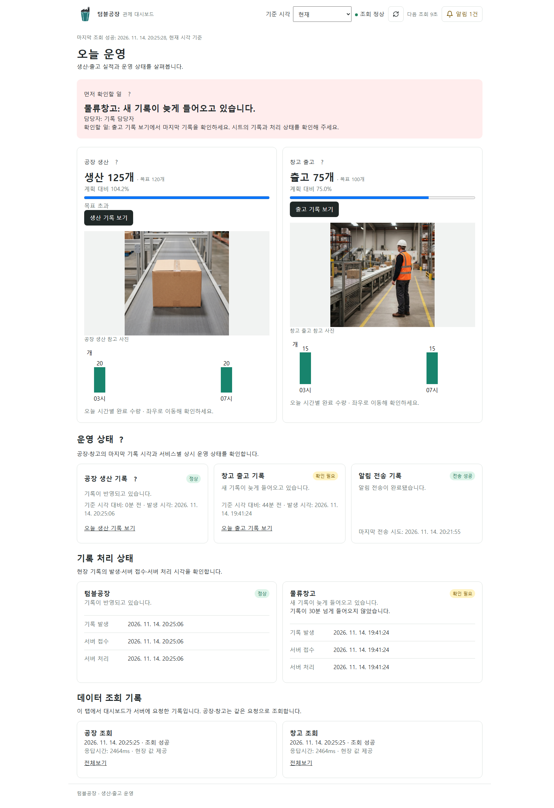
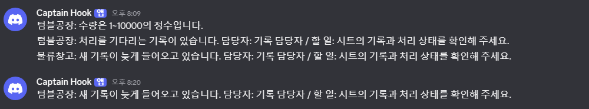

# 따라하기 프롬프트

각 회차를 순서대로 진행합니다. 같은 프로젝트 폴더에서 코드 블록을 하나씩 AI에게 보내세요. 결과를 확인한 뒤 다음 프롬프트로 넘어갑니다.

## 1회차: 화면 틀 만들기

### 완성 예시




### 준비

빈 작업 폴더를 만들고 AI 도구에서 엽니다.

### 따라하기

```text
새 폴더에서 시작해줘. Node.js와 Git을 확인하고 없으면 설치 방법을 알려줘. 웹사이트는 여기서 만드는 파일과 내가 지정한 자료만 사용해줘.
```

```text
https://github.com/startup-life/aiops-dashboard-student 에서 API_CONTRACT.md와 그림 3개를 같은 경로에 받아줘. 그림은 public/assets 안의 tumble-factory-logo.png, approved/factory.png, approved/warehouse.png야.
```

```text
HTML·CSS·JavaScript로 텀블공장 운영 대시보드를 내 컴퓨터에서 실행해줘. 예시 자료로 생산·출고 목표와 완료 수량, 현장 사진, 운영 상태와 확인할 일을 보여줘.
```

```text
PC에서는 두 열, 휴대폰에서는 한 열로 보여줘. 화면에 ‘수업용 예시’를 표시해줘.
```

### 직접 확인

- 브라우저에서 대시보드를 열어 생산과 출고 카드를 확인합니다.
- 창 너비를 줄여 휴대폰 크기에서도 확인합니다.

---

## 2회차: 예시 자료와 기록 화면

### 완성 예시




### 준비

1회차 프로젝트 폴더를 열고 서버를 켭니다.

### 따라하기

```text
API_CONTRACT.md의 예시로 수량·목표 달성률·시간별 그래프를 채워줘. 시간은 한국 시간으로 표시해줘. 빠진 값은 ‘확인 불가’, 실제 0은 ‘0’으로 보여줘.
```

```text
생산 기록과 출고 기록을 각각 시간순 표로 만들어줘. 홈에서 각 표를 열고 돌아올 수 있게 해줘.
```

```text
확인할 일과 알림 목록을 보여줘. 키보드만으로 버튼을 누르고 그래프의 시간별 값을 읽을 수 있게 해줘.
```

### 직접 확인

- 예시 수량과 달성률이 맞는지 계산해 봅니다.
- 생산·출고 기록 화면을 오가고 키보드로 버튼을 눌러 봅니다.

---

## 3회차: 강사 API와 과거 조회

### 완성 예시





### 준비

2회차 프로젝트 폴더를 열고 서버를 켭니다.

### 따라하기

```text
API_CONTRACT.md의 강사 API로 오늘의 생산·출고 현황과 기록을 조회해줘. 명세에 있는 조회 요청(GET)만 사용해줘.
```

```text
현재 화면은 10초마다 갱신하고 새로고침 버튼을 만들어줘. 마지막 성공 시각을 표시해줘. 실패하면 이유를 보여주고 마지막으로 받은 값과 시각을 유지해줘.
```

```text
한국 시간으로 고른 과거 시각의 현황과 기록을 보여줘. 기록은 현황 응답의 기준 시각(viewTime)으로 조회해줘. 과거 표시·현재로 돌아가기·조회 시각과 성공/실패 이력을 추가해줘. 실패하면 마지막 자료 시각을 유지해줘.
```

### 직접 확인

- 강사 API 값과 화면의 수량을 비교합니다.
- 과거 시각을 조회한 뒤 현재로 돌아옵니다.
- 연결이 끊겼을 때 오류와 마지막 값 표시를 확인합니다.

---

## 4회차: 내 NestJS 서버

### 완성 예시





### 준비

3회차 프로젝트 폴더를 열고 서버를 켭니다.

### 따라하기

```text
API_CONTRACT.md대로 내 컴퓨터에서 NestJS 서버를 실행해줘. 수업용 생산·출고 기록과 오늘 현황을 제공하고 서버를 다시 켜도 기록이 남게 해줘.
```

```text
화면에서 강사 API와 내 서버를 선택하게 해줘. 두 곳 모두 현재 현황·기록·과거 조회가 작동하게 해줘.
```

```text
내 서버를 다시 켜서 대시보드에서 기록을 확인해줘. 연결이 끊기거나 응답 형식이 틀리면 이유를 보여줘.
```

### 직접 확인

- 화면이 내 서버의 수업용 값을 표시하는지 확인합니다.
- 기록과 과거 시각 조회를 해 봅니다.

---

## 5회차: Google 시트와 Apps Script

### 완성 예시





### 준비

4회차 프로젝트 폴더를 열고 서버를 켭니다.

### 따라하기

```text
수업용 생산·출고 기록을 내 Google 시트에 저장해줘. Apps Script 웹앱에서 API_CONTRACT.md 형식으로 현황과 기록을 조회하게 해줘.
```

```text
이 실습의 Apps Script 프로젝트와 배포를 먼저 찾아줘. 웹앱 실행 계정과 접근 범위를 설명하고 내가 확인하면 배포해줘. 로그인과 권한 승인은 내가 할게.
```

```text
강사 API·내 서버·내 Apps Script 중 하나를 선택하고 현재 연결 대상을 표시해줘. 시트의 시험 기록 한 건과 대시보드의 조회값이 같은지 확인해줘.
```

### 직접 확인

- 시트에 수업용 기록을 넣고 대시보드의 수량을 확인합니다.
- 과거 조회와 연결 실패 안내도 확인합니다.

---

## 6회차: Discord 알림과 자동 처리

### 완성 예시





### 준비

5회차 프로젝트 폴더를 열고 서버를 켭니다.

### 따라하기

```text
Apps Script가 생산·출고 기록을 읽고 처리 상태와 시각을 시트에 남기게 해줘. 같은 기록을 두 번 처리하지 말고 원본을 보존해줘.
```

```text
지연·실패 때 Discord 시험 채널에 알림을 보내고 시트에 발송 결과를 남겨줘. 웹훅 주소는 내가 비공개 설정에 넣을게. Git·화면에 주소를 남기지 마. 시험 알림 한 건을 확인해줘.
```

```text
시트 편집과 정기 점검을 자동화해줘. 먼저 실행 주기와 끄는 방법을 알려줘. 내가 확인하면 중복 없이 등록하고 시험 기록으로 실행 결과를 확인해줘.
```

### 직접 확인

- 시험 기록을 넣고 처리 이력과 Discord 시험 알림을 확인합니다.
- 실습이 끝나면 만든 자동 실행을 삭제하고 더 이상 알림이 오지 않는지 확인합니다.
