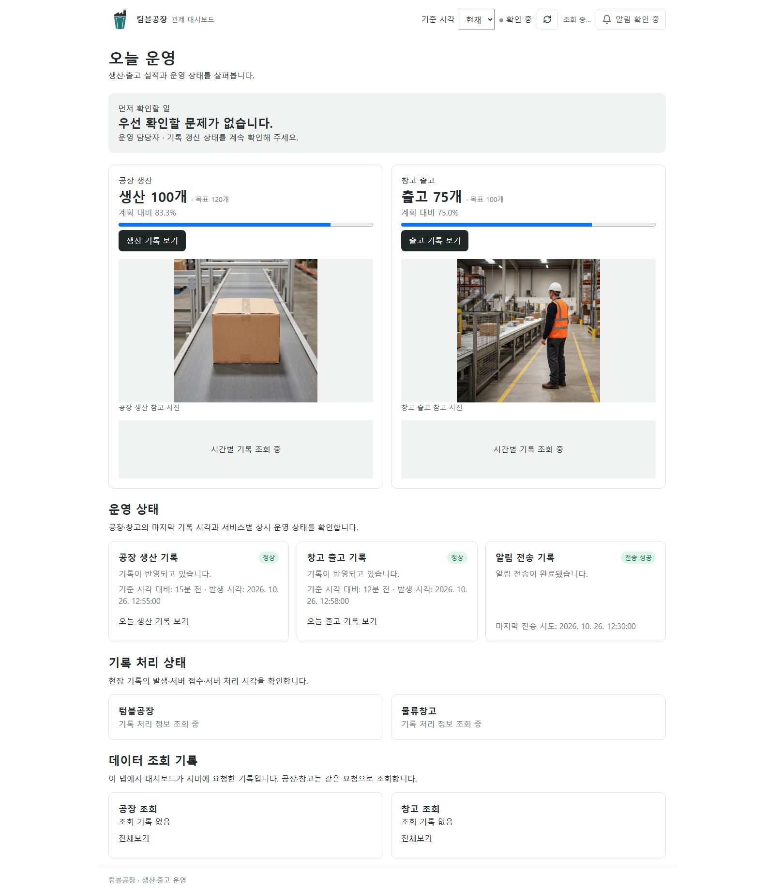
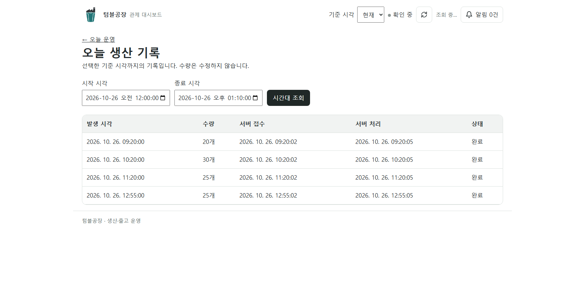

# 따라하기 프롬프트

각 회차를 순서대로 진행합니다. 같은 프로젝트 폴더에서 코드 블록을 하나씩 AI에게 보내세요. 결과를 확인한 뒤 다음 프롬프트로 넘어갑니다.

## 1회차: 화면 틀 만들기

### 완성 예시




### 준비

빈 작업 폴더를 만들고 AI 도구에서 엽니다.

### 따라하기

```text
웹사이트는 내가 보내는 프롬프트에 따라 만들어줘. 다른 저장소의 제작 가이드나 완성 코드는 읽지 말아줘.
이 폴더에서 웹 서비스를 만들 수 있게 Node.js와 Git이 있는지 확인해줘. 없으면 설치 방법을 알려줘. 설치나 로그인 중 내가 직접 해야 하는 일은 알려줘.
```

```text
https://github.com/startup-life/aiops-dashboard-student 에서 API_CONTRACT.md와 public/assets의 tumble-factory-logo.png, approved/factory.png, approved/warehouse.png만 같은 경로로 가져와줘. 강사 API 명세와 수업용 사진이야.
```

```text
HTML, CSS, JavaScript로 텀블공장 운영 대시보드를 만들어 내 컴퓨터에서 실행해줘. 생산과 출고의 목표·완료 수량, 현장 사진, 운영 상태와 확인할 일을 보여줘. 처음에는 수업용 예시 값을 사용해줘.
```

```text
컴퓨터에서는 두 열, 휴대폰에서는 한 열로 보이게 정리해줘. 값은 수업용 예시임을 표시해줘.
```

### 직접 확인

- 브라우저에서 대시보드를 열어 생산과 출고 카드를 확인합니다.
- 창 너비를 줄여 휴대폰 크기에서도 확인합니다.

---

## 2회차: 예시 자료와 기록 화면

### 완성 예시




### 준비

1회차 프로젝트 폴더를 열고 서버를 켭니다.

### 따라하기

```text
API_CONTRACT.md의 예시 자료로 생산·출고 수량과 목표 달성률, 시간별 그래프를 채워줘. 시간은 한국 시간으로 보여줘. 값이 없으면 0으로 단정하지 말고 확인할 수 없다고 표시해줘.
```

```text
생산 기록과 출고 기록 화면을 만들어 시간별 기록을 표로 보여줘. 홈에서 각 화면으로 이동하고 돌아올 수 있게 해줘.
```

```text
확인할 일과 알림 목록을 보여주고, 버튼과 그래프를 키보드로도 사용할 수 있게 해줘.
```

### 직접 확인

- 예시 수량과 달성률이 맞는지 계산해 봅니다.
- 생산·출고 기록 화면을 오가고 키보드로 버튼을 눌러 봅니다.

---

## 3회차: 강사 API와 과거 조회

### 완성 예시


### 준비

2회차 프로젝트 폴더를 열고 서버를 켭니다.

### 따라하기

```text
API_CONTRACT.md에 적힌 강사 API를 연결해서 오늘 생산·출고 현황과 기록을 보여줘. API는 읽기 전용으로 사용하고 강사의 조작 기능은 호출하지 마.
```

```text
현재 자료를 10초마다 다시 조회하고 새로고침 버튼과 마지막 조회 시각을 표시해줘. 실패하면 이유를 알리고 마지막으로 받은 값은 유지해줘.
```

```text
기준 시각을 골라 과거 현황과 생산·출고 기록을 조회하게 해줘. 과거 자료임을 표시하고 현재로 돌아오는 버튼을 만들어줘. 조회에 실패하면 마지막 자료의 실제 시각을 유지하고, 조회한 시각과 성공·실패 이력도 보여줘.
```

### 직접 확인

- 강사 API 값과 화면의 수량을 비교합니다.
- 과거 시각을 조회한 뒤 현재로 돌아옵니다.
- 연결이 끊겼을 때 오류와 마지막 값 표시를 확인합니다.

---

## 4회차: 내 NestJS 서버

### 완성 예시


### 준비

3회차 프로젝트 폴더를 열고 서버를 켭니다.

### 따라하기

```text
API_CONTRACT.md의 자료 형식에 맞춰 내 컴퓨터에서 실행하는 NestJS 서버를 만들어줘. 수업용 생산·출고 기록과 오늘 현황을 제공하고, 서버를 다시 켜도 예시 기록이 남게 해줘.
```

```text
대시보드의 연결 주소를 강사 API와 내 서버 중에서 바꿀 수 있게 해줘. 강사 API에서 쓰던 현황·기록·과거 조회가 내 서버에서도 작동하게 해줘.
```

```text
내 서버를 실행하고 화면을 연결해줘. 연결 실패나 자료 형식 오류가 나면 이유를 보여줘.
```

### 직접 확인

- 화면이 내 서버의 수업용 값을 표시하는지 확인합니다.
- 기록과 과거 시각 조회를 해 봅니다.

---

## 5회차: Google 시트와 Apps Script

### 완성 예시


### 준비

4회차 프로젝트 폴더를 열고 서버를 켭니다.

### 따라하기

```text
내 Google 시트에 수업용 생산·출고 기록을 저장하고 Google Apps Script 웹앱으로 조회하게 만들어줘. API_CONTRACT.md의 현황과 기록 형식을 유지해줘.
```

```text
Google 로그인, Apps Script 프로젝트 생성과 배포를 도와줘. 로그인과 권한 승인은 내가 직접 할게. 이미 만든 프로젝트가 있으면 중복 생성하지 말고, 웹앱 접근 범위를 알려준 뒤 내가 확인하면 진행해줘.
```

```text
대시보드를 내 Apps Script 웹앱에 연결해줘. 강사 API와 내 서버 연결도 선택할 수 있게 유지하고 현재 연결 대상을 표시해줘.
```

### 직접 확인

- 시트에 수업용 기록을 넣고 대시보드의 수량을 확인합니다.
- 과거 조회와 연결 실패 안내도 확인합니다.

---

## 6회차: Discord 알림과 자동 처리

### 완성 예시


### 준비

5회차 프로젝트 폴더를 열고 서버를 켭니다.

### 따라하기

```text
Apps Script가 수업용 생산·출고 기록을 읽고 처리 상태와 처리 시각을 시트에 남기게 해줘. 같은 기록을 중복 처리하지 않고 원본 기록은 보존해줘.
```

```text
처리가 지연되거나 실패하면 내 Discord 시험 채널에 알림을 보내고 시트에 전송 결과를 남겨줘. 웹훅 주소는 내가 직접 비공개 설정에 넣게 하고 Git이나 화면에 노출하지 마.
```

```text
시트 변경과 지연 기록을 확인하는 자동 실행을 설정해줘. 설정하기 전에 실행 주기와 해제 방법을 알려주고 내가 확인하면 진행해줘. 중복 트리거는 만들지 마.
```

### 직접 확인

- 시험 기록을 넣고 처리 이력과 Discord 시험 알림을 확인합니다.
- 실습이 끝나면 만든 자동 실행을 삭제하고 더 이상 알림이 오지 않는지 확인합니다.
