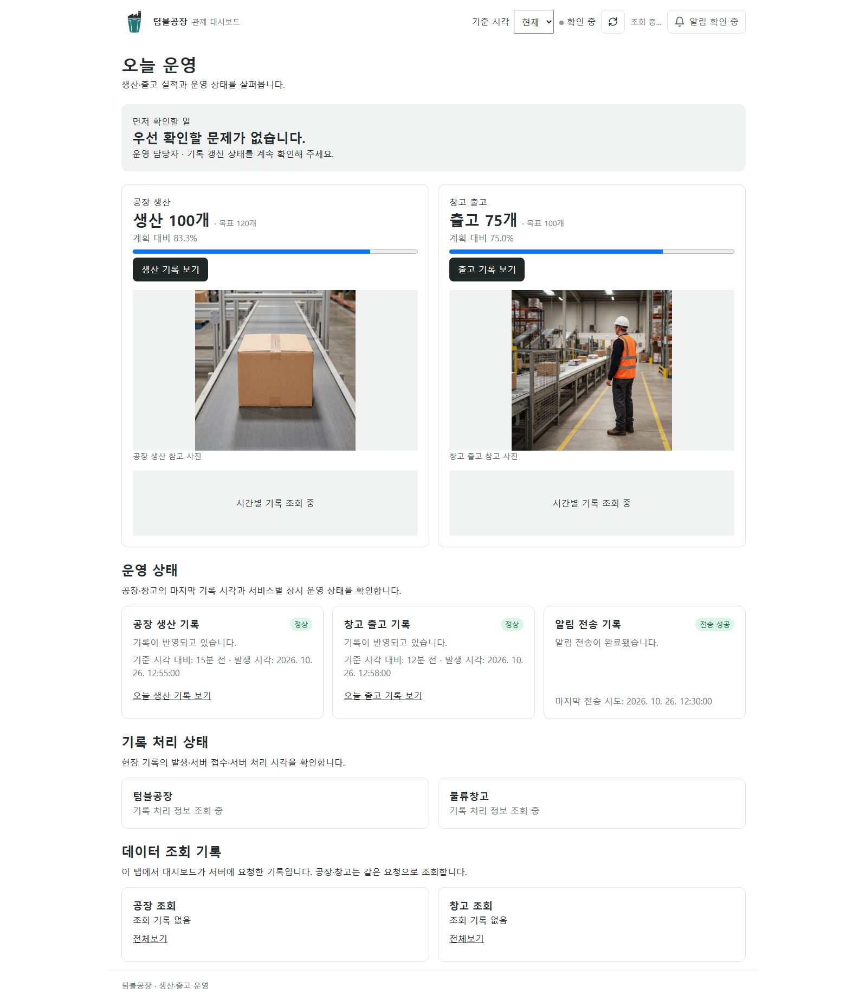

# 1회차: 화면 틀 만들기

> AI 도구에서 같은 프로젝트 폴더를 열고 프롬프트를 하나씩 보냅니다. 결과를 직접 확인한 뒤 다음으로 넘어갑니다. 오류가 나면 오류 문구를 그대로 보내 해결을 요청하세요. 화면은 예시와 달라도 됩니다.
>
> 실제 현장 정보 대신 수업용 자료를 사용합니다.

## 완성 예시




## 준비

빈 작업 폴더를 만들고 AI 도구에서 엽니다.

## 따라하기

```text
이 폴더에서 웹 서비스를 만들 수 있게 Node.js와 Git이 있는지 확인해줘. 없으면 설치 방법을 알려줘. 설치나 로그인 중 내가 직접 해야 하는 일은 알려줘.
```

```text
https://github.com/startup-life/aiops-dashboard-student 에서 API_CONTRACT.md와 public/assets 폴더를 가져와줘. 수업용 자료만 사용하고 다른 문서는 가져오지 마.
```

```text
HTML, CSS, JavaScript로 텀블공장 운영 대시보드를 만들어 내 컴퓨터에서 실행해줘. 생산과 출고의 목표·완료 수량, 현장 사진, 운영 상태와 확인할 일을 보여줘. 처음에는 수업용 예시 값을 사용해줘.
```

```text
컴퓨터에서는 두 열, 휴대폰에서는 한 열로 보이게 정리해줘. 값은 수업용 예시임을 표시해줘.
```

## 직접 확인

- 브라우저에서 대시보드를 열어 생산과 출고 카드를 확인합니다.
- 창 너비를 줄여 휴대폰 크기에서도 확인합니다.
