# 1회차 목표: 화면 틀 만들기

## 1회차 완성 화면


PC 화면 위쪽


PC 전체 화면

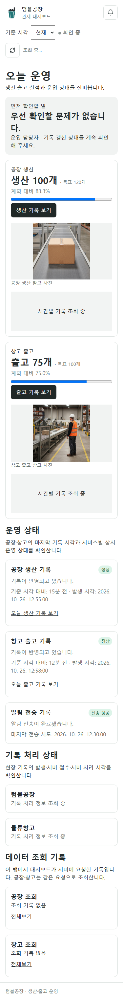

결과 : 휴대폰 폭 전체 화면

오늘 운영 화면의 레이아웃을 만들고 다섯 영역을 위에서 아래로 배치합니다.
`npm.cmd start`로 화면 서버를 켜면 http://127.0.0.1:4173 에서 화면을 볼 수 있습니다. 위에서부터 먼저 확인할 일, 생산·출고 카드, 운영 상태, 기록 처리 상태, 데이터 조회 기록이 보입니다. PC에서는 생산·출고 카드가 두 열로 놓입니다. 화면 폭이 375px이면 한 열로 놓입니다.
숫자는 아직 고정값(생산 100개 · 목표 120개, 출고 75개 · 목표 100개)입니다. 버튼과 화면 이동 기능은 2회차부터 연결합니다.

---

## 시작 전에

빈 폴더 `C:\ai-class\tumble-dashboard`에서 시작합니다. 코드는 하나도 없습니다.

Windows 10·11 PC, ego (lite) 브라우저, AI 도구를 준비합니다. Node.js와 Git은 1-1에서 AI 도구가 설치 여부를 확인하고 없으면 설치합니다. 개인 Google 계정은 5회차부터 쓰고 Discord 계정은 6회차에 씁니다.

아래를 먼저 합니다.

1. AI 도구: 강사가 안내한 AI 도구를 설치하고 로그인합니다.
2. 웹 서비스 폴더 만들기: 파일 탐색기에서 `C:\ai-class` 폴더와 그 안의 `tumble-dashboard` 폴더를 만듭니다. OneDrive가 동기화하는 폴더나 한글이 든 경로는 쓰지 않습니다.
3. AI 도구로 폴더 열기: AI 도구에서 `C:\ai-class\tumble-dashboard` 폴더를 엽니다. 폴더를 신뢰할지 물으면 신뢰합니다. 그다음 새 대화를 시작합니다.

## 먼저 알아 둘 말

- **AI 도구**: 프롬프트를 붙여 넣는 AI 프로그램입니다. 강사가 안내한 것을 씁니다.
- **웹 서비스 폴더**: `C:\ai-class\tumble-dashboard`입니다. "시작 전에"에서 빈 폴더로 만들고, AI 도구에서 이 폴더를 열어 두고 작업합니다.
- **PowerShell 창**: Windows에서 명령을 입력하는 창입니다. 시작 메뉴에서 "PowerShell"을 찾아 엽니다. 용도에 따라 아래처럼 나누어 부릅니다.
- **서버 창**: 서버가 켜져 있는 PowerShell 창입니다. 1-4에서 AI 도구가 새로 열어 그 창에서 화면 서버를 켭니다. 수업 내내 켜 둡니다. 4회차부터 서버가 둘이 됩니다. 화면 서버가 켜진 창은 "화면 창"이라고 부릅니다. 내 서버가 켜진 창은 "서버 창"이라고 부릅니다.
- **명령 창**: 명령을 입력하려고 서버 창과 별도로 여는 PowerShell 창입니다. 명령은 이 창에 입력합니다. AI 도구에 실행을 부탁해도 됩니다. 3회차부터 씁니다.
- **강사 API**: 강사가 인터넷에서 운영하는 API 서버입니다. 화면에 쓸 자료를 보내 줍니다. 3회차부터 화면이 여기서 생산·출고 자료를 받습니다. 주소와 자료 모양은 강사가 준 `API_CONTRACT.md`에 있습니다.
- **수업 저장소**: 강사가 GitHub에 둔 공개 저장소입니다. 규칙 파일, 보충 문서, 강사가 준 파일과 회차별 완료 코드가 들어 있습니다. GitHub 계정 없이 받을 수 있습니다. 이 프로젝트에서는 `class`라는 이름으로 부릅니다.
- **완료 브랜치**: 수업 저장소에서 회차를 끝낸 코드를 담은 브랜치입니다. 1회차는 `milestone-1`, 6회차는 `main`입니다.
- **규칙 파일**: AI 도구가 일하는 방식을 적은 `AGENTS.md`입니다. 회차 첫 번호(1회차는 1-2)에서 AI 도구가 수업 저장소에서 이 파일을 가져와 따릅니다. 파일을 고쳐도 다음 회차 첫 번호에서 수업 저장소의 파일로 다시 바뀝니다.
- **보충 문서**: 주소, 화면 글자, 이름 같은 자세한 약속을 적은 `docs\guide\session-N.md`입니다. 프롬프트는 무엇을 위해 어디에 어떤 기능을 더할지만 말합니다. 자세한 내용은 AI 도구가 이 문서와 완료 브랜치 코드에서 찾아 따릅니다. 사람은 읽지 않아도 따라 할 수 있습니다.
- **직접 하기**: 프롬프트를 보내지 않고 하는 일입니다. 단계 제목 끝에 붙으면 그 단계 전체를 직접 합니다. 줄 앞에 붙으면 그 줄에 적힌 일을 직접 합니다. 적힌 대로 직접 해도 됩니다. AI 도구에 "3-17 단계를 해 주세요.", "4-5의 직접 하기를 해 주세요."처럼 부탁해도 됩니다.
- **헤더 (화면 맨 위)**: 로고와 기준 시각·새로고침·알림 버튼이 놓인 화면 맨 위 줄입니다. 보충 문서의 "머리 부분"과 "헤더"도 이 줄을 말합니다.
- **하는 일·목표·완료 기준**: 단계마다 프롬프트 상자 아래에 나오는 세 줄입니다. 하는 일은 그 단계에서 화면이나 파일에 무엇이 생기는지 설명합니다. 목표는 그 단계가 필요한 까닭입니다. 완료 기준은 화면이나 PowerShell 창에서 어떤 결과를 확인해야 하는지 설명합니다.

## 진행 방법

- 이 회차 문서는 GitHub의 수업 저장소 `main` 화면에서 열어 둡니다. 웹 서비스 폴더에는 들어 있지 않습니다.
- 프롬프트 상자 하나를 통째로 복사해 AI 도구 대화창에 붙여 넣습니다. 앞 번호가 끝난 뒤에 다음 번호를 보냅니다.
- 프롬프트 맨 앞의 `[1-5]` 같은 표시는 단계 번호입니다. 맨 끝의 "자세한 내용은 … 참고해 주세요." 줄은 보충 문서의 절을 가리킵니다. 그 줄의 큰따옴표 안은 절 제목입니다. 둘 다 지우지 말고 같이 보냅니다.
- AI 도구가 "이미 되어 있습니다"라고 답하면 그 번호의 "완료 기준"대로 확인합니다. 기준에 맞으면 다음 번호로 넘어갑니다. 앞 번호에서 먼저 만들어졌을 수 있습니다.
- AI 도구가 파일을 만들거나 명령을 실행해도 되는지 물으면 허용합니다.
- 서버를 끌 때는 서버 창을 닫거나 그 창에서 Ctrl+C를 누릅니다. "일괄 작업을 끝내시겠습니까 (Y/N)?"가 나오면 `Y`를 칩니다. AI 도구에 "화면 서버를 꺼 주세요."라고 부탁해도 됩니다. 다시 켤 때는 AI 도구에 "화면 서버를 켜 주세요."라고 보냅니다.
- 1-5부터 1회차 끝까지 프롬프트는 화면 파일을 고칩니다. 서버는 켜 둔 채로 ego (lite) 브라우저에서 새로고침(F5)하면 바뀐 내용이 보입니다.
- 완료 기준대로 됐는지 헷갈리면 AI 도구에 부탁해도 됩니다. "이 번호의 완료 기준대로 됐는지 ego (lite) 브라우저로 확인해 주세요."라고 보냅니다.
- "완료 기준"과 다르게 나오면 화면의 글이나 서버 창·명령 창의 빨간 줄을 그대로 복사합니다. "이렇게 나와요. 고쳐 주세요."와 함께 AI 도구에 붙여 넣습니다.
- 답이 이상해지면 새 대화를 열고 1-2의 프롬프트를 다시 보낸 뒤, 하던 번호부터 이어 갑니다.
- 화면 색과 간격은 예시와 조금 달라도 됩니다. "완료 기준"에 적힌 글자와 동작이 맞으면 됩니다.

## 1-1. 작업 준비

```text
[1-1] 이 폴더에서 웹 서비스를 만들 준비를 하기 위해, 이 PC에 Node.js(22 이상, 없으면 24 LTS)와 Git이 있는지 확인하고 없으면 설치해 주세요.
설치는 30초를 넘길 수 있으니 새 PowerShell 창에서 실행하고(winget이면 --accept-source-agreements --accept-package-agreements를 붙여서), 끝났는지는 20초 이하 간격으로 따로 확인해 주세요. 설치를 시작할 때 설치 승인 창이 뜨면 "예"를 눌러 달라고 먼저 알려 주세요. 설치한 뒤 명령을 찾지 못하면 PATH(프로그램 찾는 경로)를 다시 읽어 확인해 주세요.
그다음 이 폴더가 git 저장소가 아니면 내 git 저장소로 만들어 주세요. 끝나면 Node.js와 Git의 버전만 한 줄로 알려 주세요.
```

- 하는 일: AI 도구가 이 PC에 Node.js와 Git이 있는지 확인하고 없으면 설치합니다. 그런 다음 웹 서비스 폴더를 내 git 저장소로 만듭니다.
- 목표: Node.js는 1-4부터 화면 서버를 켤 때 씁니다. Git은 1-2에서 수업 자료를 받을 때 씁니다.
- 직접 하기: 파일 탐색기에서 파일 확장명 표시를 켭니다. Windows 10은 보기 메뉴에서 '파일 확장명'을 켭니다. Windows 11은 보기 메뉴의 '표시'에서 '파일 확장명'을 켭니다.
- 완료 기준: AI 도구 답에 `v22.` 이상인 Node.js 버전과 Git 버전이 나옵니다.
- 막히면: AI 도구가 새로 설치한 Node.js나 Git을 찾지 못한다고 하면 "경로를 다시 읽어 실행해 주세요."라고 보냅니다.
- 알아 두기: 설치 중 "이 앱이 디바이스를 변경할 수 있도록 허용하시겠어요?" 창이 뜨면 "예"를 누릅니다. 화면에 창이 보이지 않으면 작업 표시줄에서 깜박이는 방패 아이콘을 누릅니다.

## 1-2. 지침 세팅

```text
[1-2] 수업 자료를 이 프로젝트로 가져오기 위해, 수업 저장소 https://github.com/startup-life/aiops-dashboard-student 를 class라는 이름의 원격 저장소로 더해(class가 이미 있으면 더하지 않고 받기만 합니다) 받아 오고, class/milestone-0의 AGENTS.md, docs/guide, API_CONTRACT.md, public/assets, .gitignore를 git checkout class/milestone-0 -- (경로) 꼴로 이 프로젝트로 가져와 주세요(브랜치는 옮기지 않습니다).
처음 받아 올 때는 자료가 커서 30초를 넘길 수 있으니, 받는 명령(git fetch)은 새 PowerShell 창에서 실행하고 끝났는지는 20초 이하 간격으로 따로 확인해 주세요. git 명령을 찾지 못하면 PATH(프로그램 찾는 경로)를 다시 읽어 실행해 주세요.
그다음 AGENTS.md를 작업 지침으로 삼아 주세요. 프롬프트에 없는 상세 구현은 docs/guide의 회차 문서와 그 회차 완료 브랜치 코드(class/milestone-1)에서 확인합니다.
이번 번호에서는 AGENTS.md와 docs/guide의 회차 문서를 끝까지 읽고, 만드는 일은 다음 번호부터 합니다. 답 맨 앞에 "읽은 문서: session-1 ~ session-1" 꼴로 읽은 문서를 한 줄로 알려 주세요.
```

- 하는 일: 수업 저장소의 `milestone-0` 브랜치에서 웹 서비스 폴더로 파일을 가져옵니다. 강사가 준 파일(로고, 현장 사진 두 장, `API_CONTRACT.md`)이 포함됩니다. 규칙 파일(`AGENTS.md`)과 1회차 보충 문서(`docs\guide`)도 가져옵니다. AI 도구가 규칙 파일과 보충 문서를 읽어 둡니다.
- 목표: 프롬프트에 없는 주소, 화면 글자, 이름도 있습니다. AI 도구는 이를 규칙 파일과 보충 문서, 완료 브랜치 코드에서 찾아 따릅니다. 그래서 화면을 만드는 1-3보다 먼저 보냅니다.
- 완료 기준: 파일 탐색기의 웹 서비스 폴더에 `AGENTS.md`, `API_CONTRACT.md`, `docs`, `public\assets`가 생깁니다. 답 맨 앞이 "읽은 문서: session-1 ~ session-1"입니다. 새 대화를 열 때마다 이 프롬프트를 먼저 보냅니다.

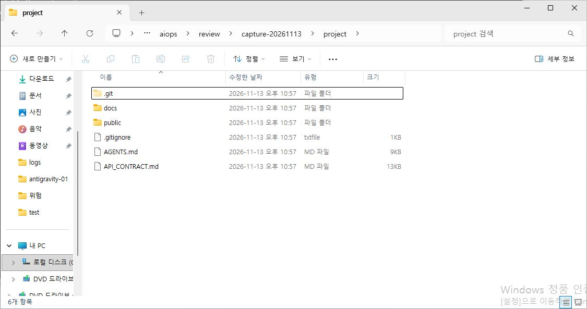

1-2 완료 후 프로젝트 폴더

## 1-3. 웹 서비스 뼈대

```text
[1-3] 텀블공장 운영 대시보드를 만들기 위해, 웹 서비스 폴더에 4173번 화면 서버와 첫 화면 뼈대를 추가해 주세요.
서버는 다음 번호에서 켜고, 카드와 꾸미기는 뒤 번호에서 만듭니다.
자세한 내용은 docs/guide/session-1.md의 "프로젝트 파일", "화면 서버"와 "화면 뼈대"를 참고해 주세요.
```

- 하는 일: 웹 서비스 폴더에 package.json (프로젝트 설정 파일)과 serve.mjs (화면 서버 파일)이 생깁니다. index.html (첫 화면 파일), 빈 styles.css (화면을 꾸미는 CSS 파일), 404.html (없는 주소에 접속했을 때 표시할 화면 파일)도 생깁니다.
- 목표: 1-4에서 켤 화면 서버와 1-5부터 채워 넣을 화면 틀을 먼저 준비합니다. 화면 틀에는 스킵 링크 (본문으로 건너뛰는 링크), 헤더 (화면 맨 위), 본문 자리, 푸터 (바닥글)가 들어갑니다.
- 완료 기준: 웹 서비스 폴더에 `package.json`, `scripts\serve.mjs`, `public` 폴더의 `index.html`·`styles.css`·`404.html`이 생기고 `node_modules` 폴더는 없습니다. 서버는 1-4에서 켜고, 화면도 그때 봅니다.

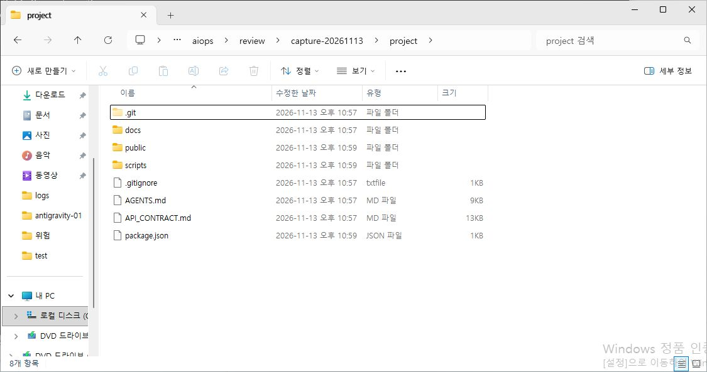

1-3 프로젝트 파일

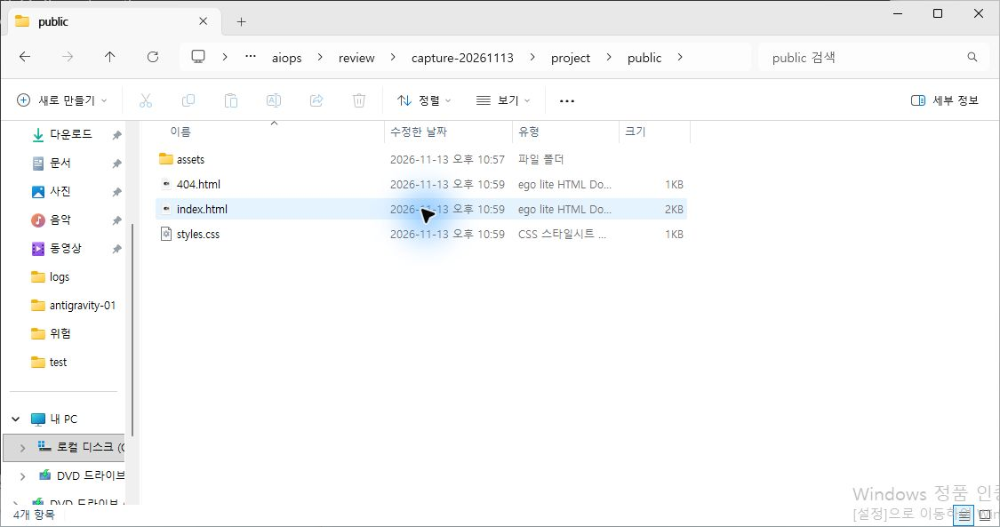

1-3 public 폴더 파일

## 1-4. 화면 서버 켜기

```text
[1-4] 만든 화면을 ego (lite) 브라우저에서 보기 위해, 새 PowerShell 창을 열어 화면 서버를 켜 주세요.
자세한 내용은 docs/guide/session-1.md의 "화면 서버 켜기"를 참고해 주세요.
```

- 하는 일: AI 도구가 새 PowerShell 창(터미널창, 여기서는 서버 창으로 활용)을 열어 그 창에서 화면 서버를 켭니다. 그다음 ego (lite) 브라우저에서 첫 화면과 없는 주소 화면을 열어 봅니다.
- 목표: ego (lite) 브라우저에서 만든 화면을 보려면 화면 서버가 켜져 있어야 합니다. 1-5부터는 파일을 고친 뒤 서버를 다시 켜지 않고 새로고침만 하면 바뀐 화면이 보입니다.
- 직접 하기: ego (lite) 브라우저에서 아래 완료 기준의 주소를 차례로 엽니다.
- 완료 기준:
  - AI 도구가 연 서버 창에 `http://127.0.0.1:4173`이 나옵니다. ego (lite) 브라우저에서 이 주소를 열면 탭 이름이 "텀블공장 · 오늘 운영"입니다. 위에서부터 "본문으로 이동", 로고와 "텀블공장"이 보입니다. 그 아래에는 "관제 대시보드", "오늘 운영"이 보입니다. 맨 아래에는 "텀블공장 · 생산·출고 운영"이 보입니다. 로고가 크게 보여도, 글자가 붙어 보여도 지금은 괜찮습니다(1-12에서 정리됩니다).
  - http://127.0.0.1:4173/abc 를 엽니다. "요청한 주소의 화면이 없습니다."와 "오늘 운영으로 이동하기" 링크가 보입니다. http://127.0.0.1:4173/api/v1/snapshot 도 엽니다. 여기에는 404 화면이 아니라 `{"error":"이 서버는 화면 파일만 보냅니다. …"}` 글자가 보입니다. 자료는 3회차부터 이 화면 서버가 아니라 API 서버에서 받습니다.
- 막히면: 서버 창에 `EADDRINUSE`나 빨간 줄이 나오면 그 줄을 복사해 "이렇게 나와요. 고쳐 주세요."와 함께 AI 도구에 붙여 넣습니다.
- 알아 두기: AI 도구가 "이미 켜져 있습니다"라고 답하면 앞서 켠 서버 창이 있는 것입니다. 새 창을 기다리지 않고 ego (lite) 브라우저에서 주소만 엽니다. 서버 창은 수업 내내 켜 두면 됩니다. 닫았으면 AI 도구에 "화면 서버를 켜 주세요."라고 보냅니다.

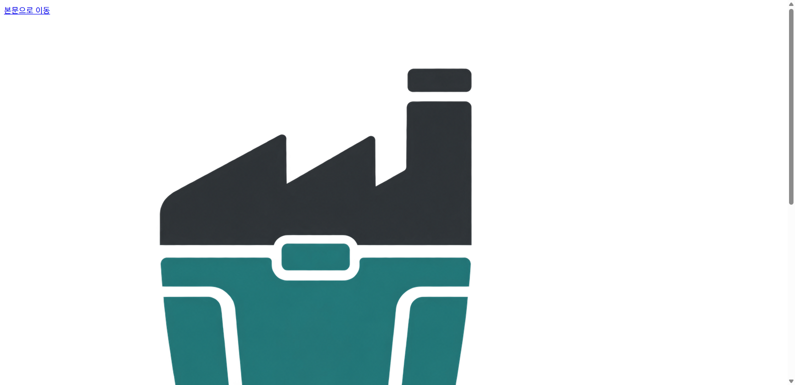

1-4 첫 화면 위쪽

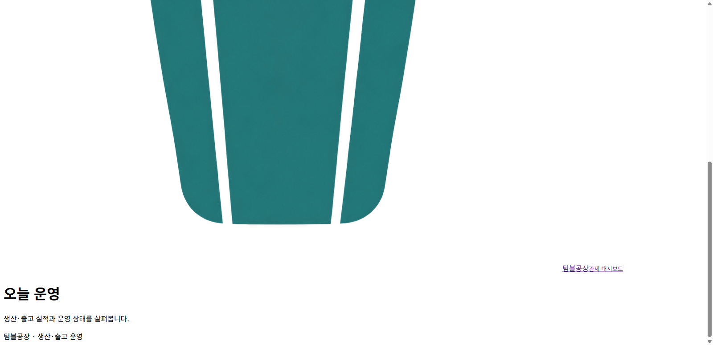

1-4 첫 화면 아래쪽

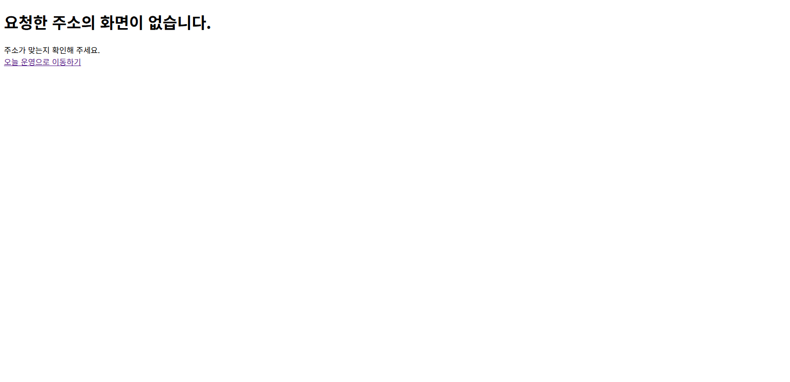

1-4 없는 주소 화면

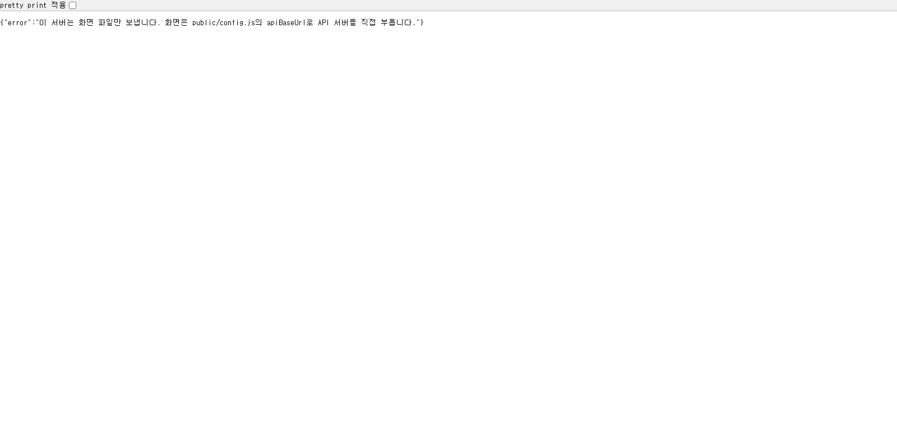

1-4 API 주소 안내

## 1-5. 화면 맨 위 오른쪽 자리

```text
[1-5] 자료를 다시 조회하고 알림을 볼 자리를 마련하기 위해, 헤더 (화면 맨 위) 오른쪽에 기준 시각 고르기와 새로고침·알림 버튼을 추가해 주세요.
동작은 2회차부터 넣습니다.
자세한 내용은 docs/guide/session-1.md의 "머리 부분 오른쪽 자리"를 참고해 주세요.
```

- 하는 일: 화면 맨 위 오른쪽에 기준 시각 상자와 조회 상태 글이 놓입니다. 이어서 새로고침 버튼과 다음 조회 글, 알림 버튼이 차례로 놓입니다. 알림 목록이 들어갈 자리는 숨겨 둡니다.
- 목표: 지금은 자리만 둡니다. 알림 목록은 2회차, 새로고침 버튼의 조회와 기준 시각 고르기는 3회차에 이 자리에서 동작합니다.
- 완료 기준: "기준 시각 [현재]", "확인 중"이 보입니다. 이어서 새로고침 아이콘과 "조회 중…", 종 아이콘과 "알림 확인 중"이 차례로 보입니다.

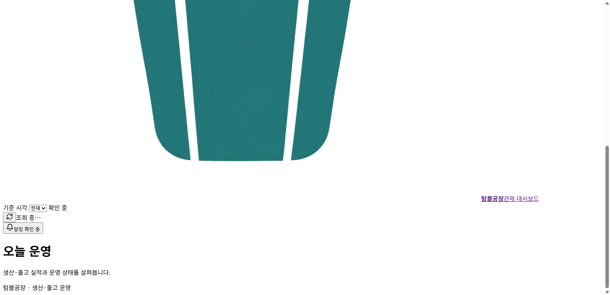

1-5 기준 시각과 버튼 자리

## 1-6. 먼저 확인할 일

```text
[1-6] 오늘 가장 먼저 볼 문제를 알리기 위해, "오늘 운영" 설명 아래에 "먼저 확인할 일" 상자를 추가해 주세요.
자세한 내용은 docs/guide/session-1.md의 "먼저 확인할 일"을 참고해 주세요.
```

- 하는 일: "오늘 운영" 설명 아래에 첫째 상자가 생깁니다. 이 상자에는 문제가 없을 때의 안내가 들어갑니다. 담당자를 적을 빈 줄은 숨겨 둡니다.
- 목표: 오늘 운영 영역의 첫째 상자입니다. 숨긴 담당자 줄은 2회차에 쓰고, 3회차에는 조회가 실패하면 조회 실패 항목이 이 상자에 먼저 나옵니다.
- 완료 기준: "오늘 운영" 설명 아래에 "먼저 확인할 일"이 보입니다. 그 아래에는 "우선 확인할 문제가 없습니다."가 보입니다. 이어서 "운영 담당자 · 기록 갱신 상태를 계속 확인해 주세요."가 보입니다.

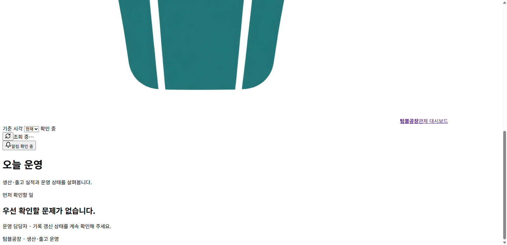

1-6 먼저 확인할 일

## 1-7. 생산·출고 카드

```text
[1-7] 생산과 출고 실적을 목표와 견주어 보기 위해, "먼저 확인할 일" 아래에 공장 생산 카드와 창고 출고 카드를 추가해 주세요.
사진과 그래프는 다음 번호에서 넣습니다.
자세한 내용은 docs/guide/session-1.md의 "생산·출고 카드"를 참고해 주세요.
```

- 하는 일: 공장 생산 카드와 창고 출고 카드에 고정된 숫자를 표시합니다. 계획 대비 비율, 진행 막대, 기록 보기 링크도 생깁니다.
- 목표: 화면의 중심 카드입니다. 1-8에서 사진과 그래프 자리를 더합니다. 2회차에는 예시 자료로 채웁니다. 3회차부터는 강사 API의 실제 값으로 채웁니다.
- 완료 기준: "공장 생산"에 "생산 100개 · 목표 120개", "계획 대비 83.3%"가 보입니다. 막대는 83.3% 지점까지 찹니다. "창고 출고"에 "출고 75개 · 목표 100개", "계획 대비 75.0%"가 보입니다. 막대는 75% 지점까지 찹니다. "생산 기록 보기"를 누르면 주소 끝이 `#/records/factory`로 바뀝니다(화면은 아직 그대로입니다). "· 목표"가 앞 글자에 붙어 보여도 지금은 괜찮습니다(1-11에서 정리됩니다).

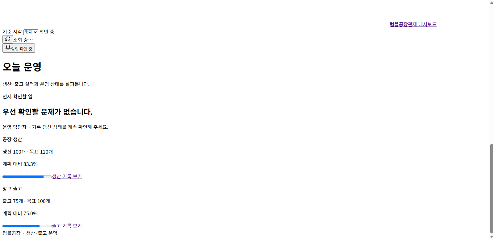

1-7 생산·출고 카드

## 1-8. 현장 사진과 그래프 자리

```text
[1-8] 현장 모습과 시간별 흐름을 함께 보기 위해, 두 카드의 기록 보기 링크 아래에 현장 사진과 그래프 자리를 추가해 주세요.
그래프는 2회차에 그립니다.
자세한 내용은 docs/guide/session-1.md의 "현장 사진과 그래프 자리"를 참고해 주세요.
```

- 하는 일: 두 카드의 기록 보기 링크 아래에 현장 사진과 사진 설명이 생깁니다. 그 아래에는 그래프 자리("시간별 기록 조회 중")가 생깁니다.
- 목표: 그래프는 2회차에 이 자리에 그립니다. 사진은 3회차부터 서버에서 받은 자료의 현장 사진으로 바뀝니다.
- 완료 기준: 두 카드에 사진과 사진 설명, 그 아래 "시간별 기록 조회 중"이 보입니다. 사진이 크게 보여도 지금은 괜찮습니다. 깨진 그림 표시가 나오면 AI 도구에 "사진이 깨져 보여요. 고쳐 주세요."라고 보냅니다.

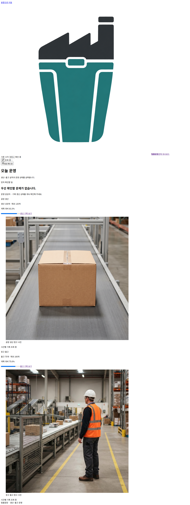

1-8 현장 사진과 그래프 자리 전체 화면

## 1-9. 운영 상태 영역

```text
[1-9] 공장·창고·알림이 잘 돌아가는지 보기 위해, 생산·출고 카드 아래에 카드 세 장이 든 "운영 상태" 영역을 추가해 주세요.
"기록 처리 상태"와 "데이터 조회 기록"은 다음 번호에서 만듭니다.
자세한 내용은 docs/guide/session-1.md의 "운영 상태 영역"을 참고해 주세요.
```

- 하는 일: 생산·출고 카드 아래에 공장·창고·알림 카드 세 장이 생깁니다. 각 카드에는 배지, 설명, 시각이 들어갑니다.
- 목표: 배지 색은 1-11에서 꾸밉니다. 알림 카드는 6회차에 Discord 알림을 보낸 결과("전송 성공")를 표시합니다.
- 완료 기준: "운영 상태" 제목과 안내 문장이 보입니다. 세 카드의 배지는 "정상", "정상", "전송 성공"입니다. 각 카드에는 설명과 시각도 보입니다. 공장·창고 카드에만 기록 보기 링크가 있고 알림 카드에는 없습니다.

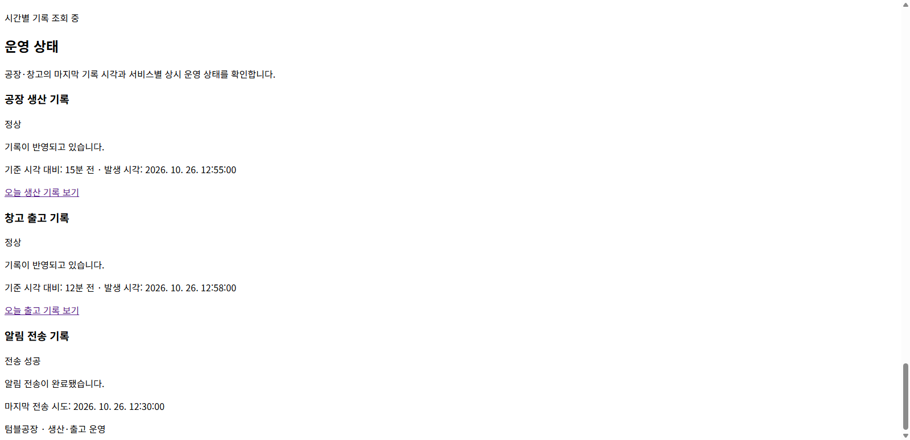

1-9 운영 상태

## 1-10. 기록 처리 상태와 데이터 조회 기록

```text
[1-10] 기록 처리 흐름과 조회한 기록을 볼 자리를 만들기 위해, 맨 아래에 "기록 처리 상태"와 "데이터 조회 기록" 영역을 추가해 주세요.
자세한 내용은 docs/guide/session-1.md의 "기록 처리 상태와 데이터 조회 기록"을 참고해 주세요.
```

- 하는 일: 맨 아래에 "기록 처리 상태"(텀블공장, 물류창고) 카드가 생깁니다. 이어서 "데이터 조회 기록"(공장 조회, 창고 조회) 카드가 생깁니다.
- 목표: 오늘 운영의 마지막 두 영역입니다. 기록 처리 상태 카드는 2회차에 채웁니다. 데이터 조회 기록 카드는 3회차에 채웁니다. "전체보기"를 누르면 2회차부터 조회 기록 화면이 열립니다.
- 완료 기준: "기록 처리 상태" 아래에 "텀블공장", "물류창고" 카드가 보입니다. 두 카드에는 "기록 처리 정보 조회 중"이 표시됩니다. "공장 조회", "창고 조회" 카드에는 "조회 기록 없음"과 "전체보기"가 보입니다. "전체보기"를 누르면 주소 끝이 `#/queries/factory`, `#/queries/warehouse`로 바뀝니다.

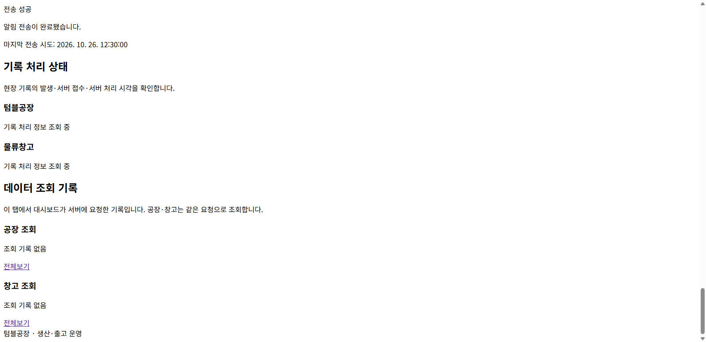

1-10 기록 처리 상태와 데이터 조회 기록

## 1-11. 기본 모양과 카드 꾸미기

```text
[1-11] 화면을 읽기 쉽게 하기 위해, styles.css (화면을 꾸미는 CSS 파일)에 화면 전체의 기본 모양과 카드·배지·기록 보기 버튼 모양을 추가해 주세요.
이번 번호에서는 styles.css (화면을 꾸미는 CSS 파일)만 고칩니다.
자세한 내용은 docs/guide/session-1.md의 "화면 전체 기본 모양"과 "카드와 버튼 링크 모양"을 참고해 주세요.
```

- 하는 일: 새로고침하면 글꼴, 제목 크기, 초점 테두리, 카드·배지·버튼 링크의 모양이 바뀝니다.
- 목표: 1-11부터 1-14까지는 `public\styles.css` (꾸미기 파일)을 채웁니다. 1-7에서 앞 글자에 붙어 보이던 "· 목표"도 여기서 정리됩니다.
- 완료 기준: 새로고침하면 글꼴과 제목 크기가 바뀌고, Tab 키로 이동하면 초록 테두리가 보입니다. 카드는 둥근 상자로 보입니다. "생산 100개"가 크게 보이고, "· 목표 120개"가 옆에 작은 회색 글자로 보입니다. "정상", "정상", "전송 성공"은 초록 배지로 표시됩니다. "생산 기록 보기"와 "출고 기록 보기"는 검은 버튼으로 보입니다.

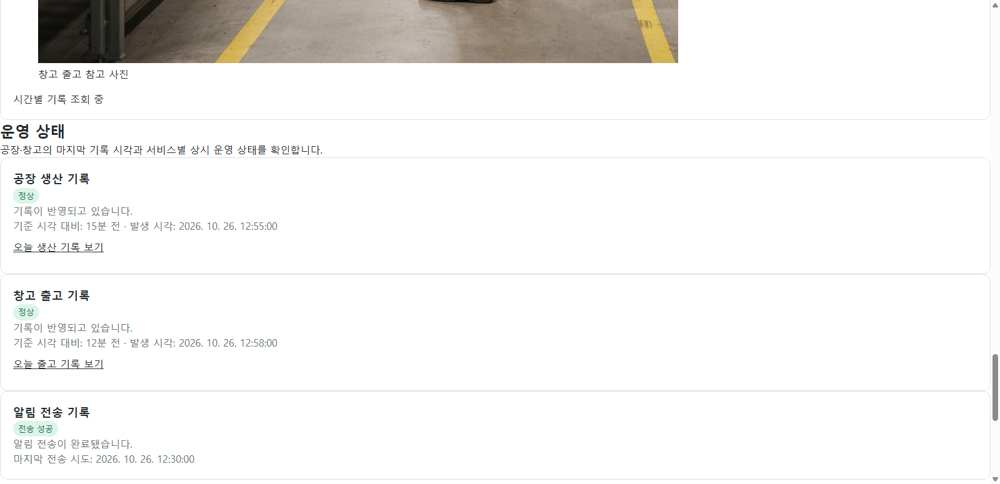

1-11 상태 카드 꾸미기

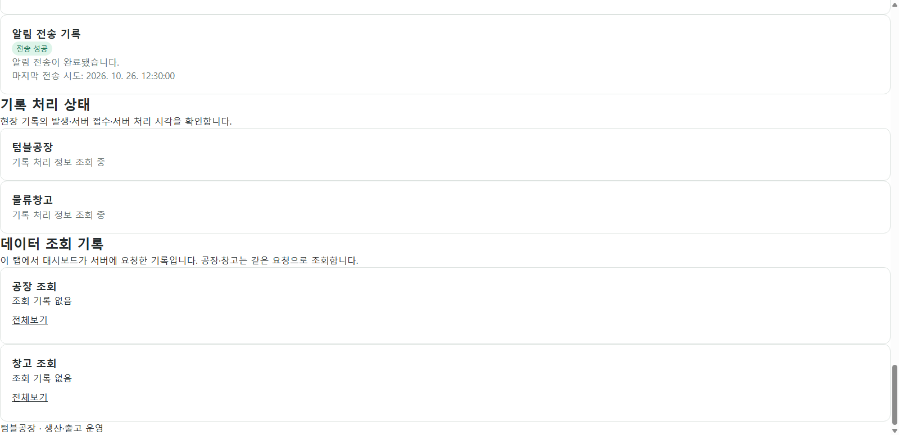

1-11 아래 카드 꾸미기

## 1-12. 화면 맨 위 모양

```text
[1-12] 화면 맨 위를 한눈에 읽기 쉽게 하기 위해, styles.css (화면을 꾸미는 CSS 파일)에 로고와 버튼이 한 줄로 놓이는 헤더 (화면 맨 위) 모양을 추가해 주세요.
두 열 배치와 휴대폰 폭 모양은 뒤 번호에서 만듭니다.
자세한 내용은 docs/guide/session-1.md의 "머리 부분 모양"을 참고해 주세요.
```

- 하는 일: 화면 맨 위에 로고와 조작 버튼들이 한 줄로 놓입니다. 왼쪽에는 로고가, 오른쪽에는 기준 시각·조회 상태·새로고침·알림이 놓입니다.
- 목표: 1-4에서 크게 보이던 로고와 붙어 보이던 글자가 여기서 정리됩니다.
- 완료 기준: 창을 넓게(1440px 정도) 두면 화면 맨 위가 한 줄입니다. 왼쪽은 로고, 오른쪽은 기준 시각·확인 중·새로고침·조회 중…·알림 확인 중입니다.

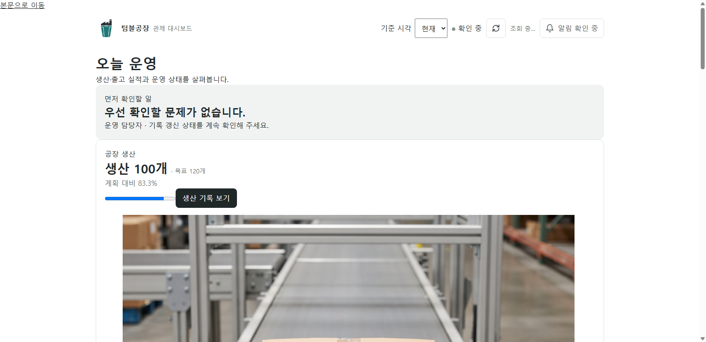

1-12 화면 맨 위 모양

## 1-13. 두 열 배치와 사진 칸

```text
[1-13] PC에서 카드를 나란히 보기 위해, styles.css (화면을 꾸미는 CSS 파일)에 카드 두 열 배치와 사진·그래프 자리 모양을 추가해 주세요.
휴대폰 폭 모양은 다음 번호에서 만듭니다.
자세한 내용은 docs/guide/session-1.md의 "상태 줄, 건너뛰기 링크, 바닥글, 두 열 배치"와 "진행 막대, 그래프 자리, 사진 칸"을 참고해 주세요.
```

- 하는 일: PC 폭에서 생산·출고 카드는 두 열로, 운영 상태 카드는 한 줄로 놓입니다. 사진은 16:9 칸에 들어갑니다. "본문으로 이동"은 평소에는 보이지 않습니다.
- 목표: 두 현장의 상태를 나란히 비교할 수 있게 합니다. 사진 대신 글자가 들어갈 칸도 여기서 함께 꾸밉니다. 이 칸은 3회차에 사진을 받기 전이나 받지 못했을 때 쓰입니다.
- 완료 기준:
  - PC에서 생산·출고 카드가 같은 폭으로 나란히 두 열이 됩니다. 운영 상태 카드 세 장은 한 줄에 놓입니다. 사진은 잘리지 않고 16:9 칸 안에 원래 비율로 들어갑니다. 사진 양옆이 회색으로 비어 보이는 것은 정상입니다.
  - "본문으로 이동"은 평소에 보이지 않습니다. F5로 새로고침하고 아무 데도 누르지 않은 채 Tab 키를 누르면 왼쪽 위에 나타납니다. 주소창에 커서가 있으면 Tab을 몇 번 더 누릅니다.

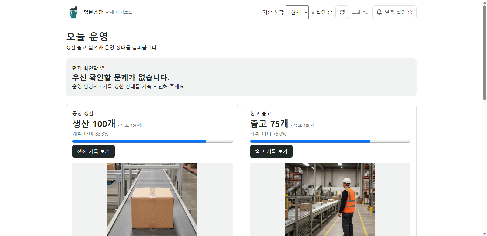

1-13 생산·출고 두 열

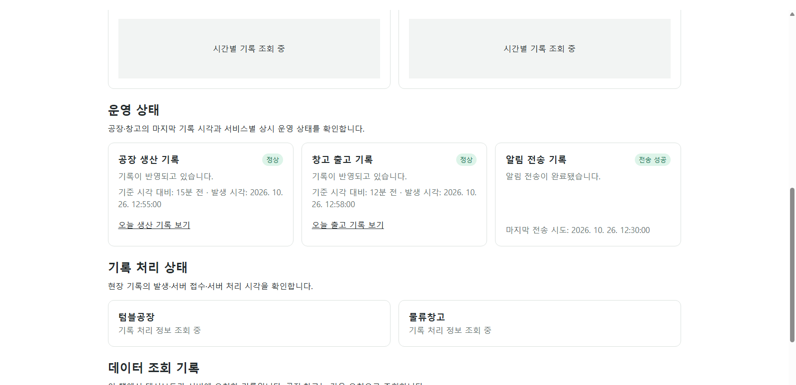

1-13 운영 상태 세 열

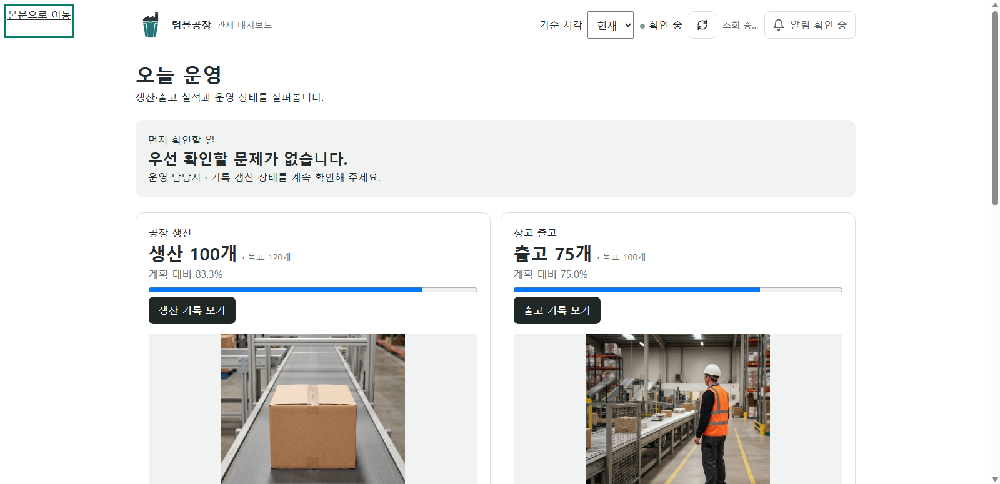

1-13 키보드 초점

## 1-14. 휴대폰 폭 화면

```text
[1-14] 휴대폰에서도 화면을 볼 수 있도록, styles.css (화면을 꾸미는 CSS 파일) 맨 끝에 미디어 쿼리 (화면 폭이 700px 이하일 때 적용할 CSS 규칙)를 추가해 주세요.
자세한 내용은 docs/guide/session-1.md의 "휴대폰 폭 화면"을 참고해 주세요.
```

- 하는 일: 폭 700px 이하에서 쓸 모양을 styles.css (화면을 꾸미는 CSS 파일) 맨 끝에 넣습니다. 화면 맨 위는 두 줄로 나뉘고 카드는 한 열로 놓입니다.
- 목표: 휴대폰 폭(375px)에서도 가로로 넘치지 않게 합니다. 2회차부터는 이 폭에서 그래프와 표를 옆으로 밀어 보는 확인도 합니다.
- 완료 기준: ego (lite) 브라우저에서 F12를 누릅니다. 기기 툴바(기기 모양 아이콘)를 켠 뒤 폭을 375px로 맞춥니다. 화면 맨 위 오른쪽에 종 아이콘만 남습니다. 기준 시각과 새로고침은 로고 아래 줄로 내려갑니다. 카드는 생산, 출고 순서로 한 열이 되고 가로로 넘치지 않습니다. 확인한 뒤 기기 툴바를 끕니다.


1-14 폭 375px 화면

## 1회차 끝 확인

- [ ] AI 도구가 연 서버 창에 `http://127.0.0.1:4173`이 나옵니다.
- [ ] ego (lite) 브라우저에서 http://127.0.0.1:4173 을 엽니다. 탭 이름이 "텀블공장 · 오늘 운영"입니다. 영역은 먼저 확인할 일, 생산·출고 카드, 운영 상태 순서로 나옵니다. 이어서 기록 처리 상태, 데이터 조회 기록이 보입니다.
- [ ] PC 폭 1440px에서 화면 맨 위가 한 줄입니다. 생산·출고 카드는 두 열이고, 운영 상태 카드 세 장은 한 줄입니다.
- [ ] 폭 375px(F12 기기 툴바)에서 카드가 한 열이고 가로로 넘치지 않습니다. 알림은 종 아이콘만 보입니다.
- [ ] 생산은 생산 100개 · 목표 120개 · 계획 대비 83.3%입니다. 출고는 출고 75개 · 목표 100개 · 계획 대비 75.0%입니다.
- [ ] 현장 사진 두 장이 잘리지 않고, 화면 맨 위에 로고가 있습니다. 로고를 누르면 주소 끝이 `#/today`가 됩니다.
- [ ] http://127.0.0.1:4173/abc 를 엽니다. "요청한 주소의 화면이 없습니다."와 "오늘 운영으로 이동하기" 링크가 보입니다. 두 안내 문장은 회색 테두리 상자로 보입니다.
- [ ] http://127.0.0.1:4173/api/v1/snapshot 를 엽니다. `{"error":"이 서버는 화면 파일만 보냅니다. …"}`가 보입니다.
- [ ] F5로 새로고침하고 아무 데도 누르지 않은 채 Tab을 누릅니다. "본문으로 이동"이 나타나고, 이동할 때 초록 테두리가 보입니다.
- [ ] 웹 서비스 폴더에 `AGENTS.md`, `API_CONTRACT.md`, `package.json`, `docs\guide\session-1.md`, `scripts\serve.mjs`, `public\index.html`, `public\404.html`, `public\styles.css`, `public\assets\`가 있습니다.

이번 회차의 자세한 약속은 [1회차 보충 문서](../docs/guide/session-1.md)에 있습니다. 2회차는 [2회차 문서](session-2.md)의 "시작 전에"부터 이어 갑니다.
