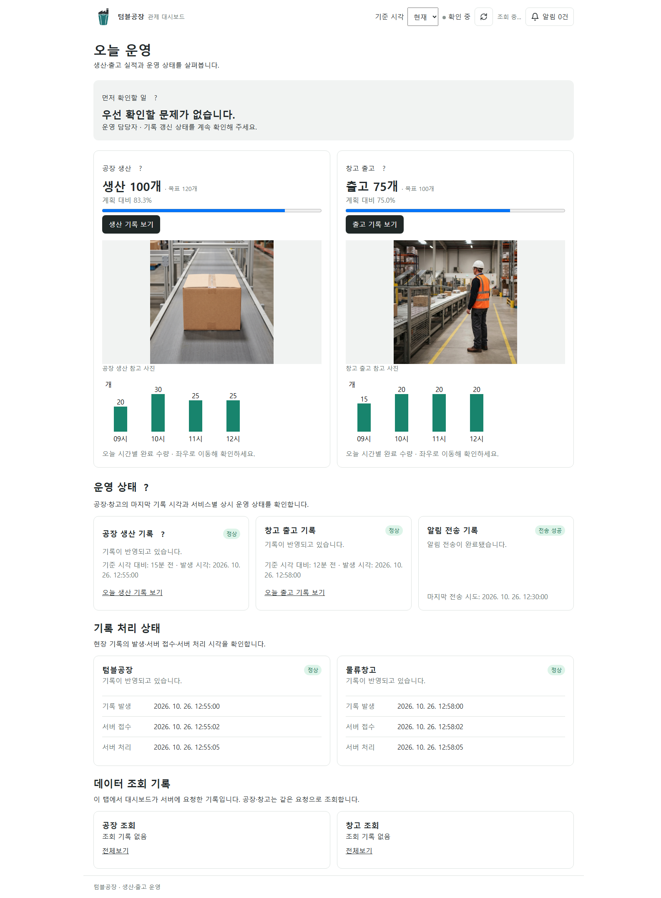
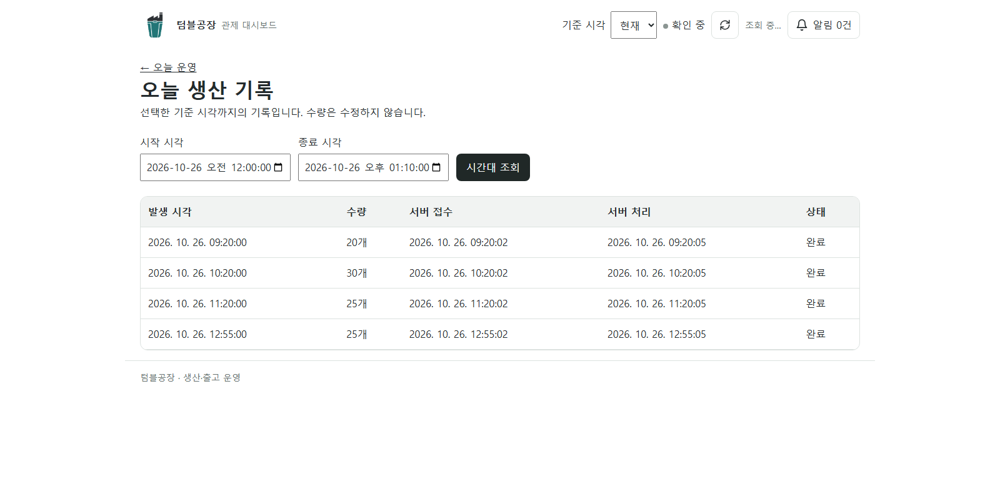

# 2회차: 예시 자료와 기록 화면

> AI 도구에서 같은 프로젝트 폴더를 열고 프롬프트를 하나씩 보냅니다. 결과를 직접 확인한 뒤 다음으로 넘어갑니다. 오류가 나면 오류 문구를 그대로 보내 해결을 요청하세요. 화면은 예시와 달라도 됩니다.
>
> 실제 현장 정보 대신 수업용 자료를 사용합니다.

## 완성 예시





## 준비

1회차 프로젝트 폴더를 열고 서버를 켭니다.

## 따라하기

```text
API_CONTRACT.md의 예시 자료로 생산·출고 수량과 목표 달성률, 시간별 그래프를 채워줘. 값이 없으면 0으로 단정하지 말고 확인할 수 없다고 표시해줘.
```

```text
생산 기록과 출고 기록 화면을 만들어 시간별 기록을 표로 보여줘. 홈에서 각 화면으로 이동하고 돌아올 수 있게 해줘.
```

```text
확인할 일과 알림 목록을 보여주고, 버튼과 그래프를 키보드로도 사용할 수 있게 해줘.
```

## 직접 확인

- 예시 수량과 달성률이 맞는지 계산해 봅니다.
- 생산·출고 기록 화면을 오가고 키보드로 버튼을 눌러 봅니다.
