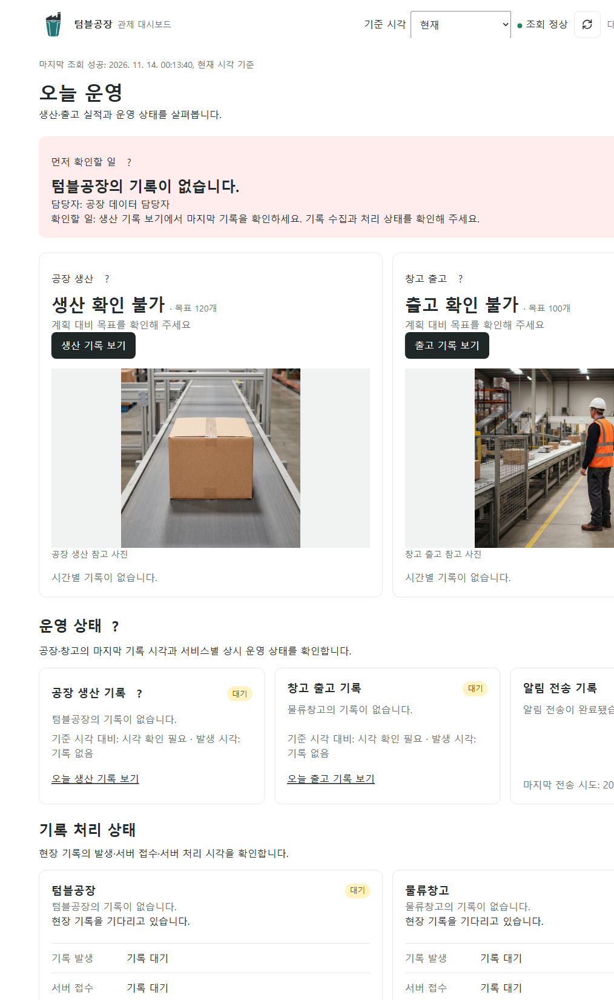
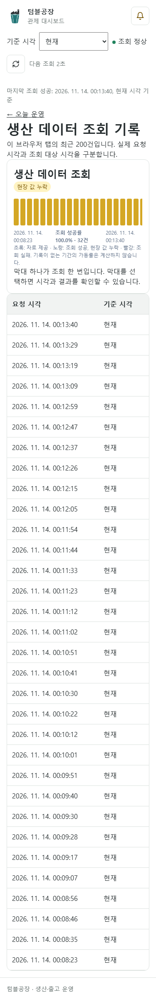

# 3회차: 강사 API와 과거 조회

> AI 도구에서 같은 프로젝트 폴더를 열고 프롬프트를 하나씩 보냅니다. 결과를 직접 확인한 뒤 다음으로 넘어갑니다. 오류가 나면 오류 문구를 그대로 보내 해결을 요청하세요. 화면은 예시와 달라도 됩니다.
>
> 실제 현장 정보 대신 수업용 자료를 사용합니다.

## 완성 예시





## 준비

2회차 프로젝트 폴더를 열고 서버를 켭니다.

## 따라하기

```text
API_CONTRACT.md에 적힌 강사 API를 연결해서 오늘 생산·출고 현황과 기록을 보여줘. API는 읽기 전용으로 사용하고 강사의 조작 기능은 호출하지 마.
```

```text
현재 자료를 10초마다 다시 조회하고 새로고침 버튼과 마지막 조회 시각을 표시해줘. 실패하면 이유를 알리고 마지막으로 받은 값은 유지해줘.
```

```text
기준 시각을 골라 과거 현황과 생산·출고 기록을 조회하게 해줘. 과거 자료임을 표시하고 현재로 돌아오는 버튼을 만들어줘. 조회한 시각과 성공·실패 이력도 보여줘.
```

## 직접 확인

- 강사 API 값과 화면의 수량을 비교합니다.
- 과거 시각을 조회한 뒤 현재로 돌아옵니다.
- 연결이 끊겼을 때 오류와 마지막 값 표시를 확인합니다.
