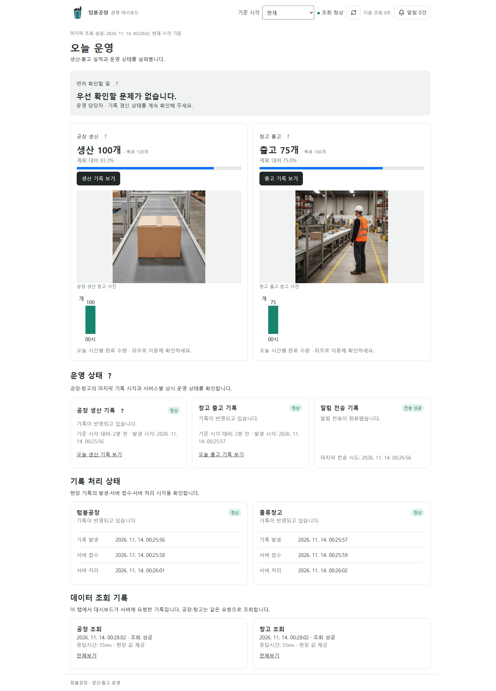
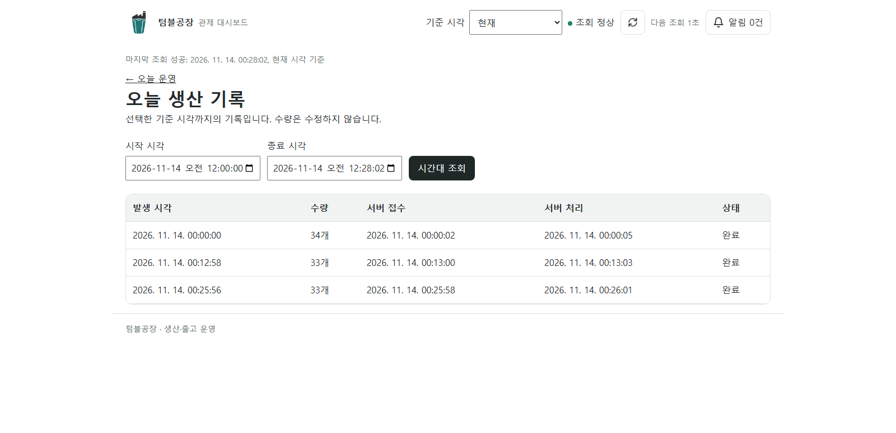

# 4회차: 내 NestJS 서버

> AI 도구에서 같은 프로젝트 폴더를 열고 프롬프트를 하나씩 보냅니다. 결과를 직접 확인한 뒤 다음으로 넘어갑니다. 오류가 나면 오류 문구를 그대로 보내 해결을 요청하세요. 화면은 예시와 달라도 됩니다.
>
> 실제 현장 정보 대신 수업용 자료를 사용합니다.

## 완성 예시





## 준비

3회차 프로젝트 폴더를 열고 서버를 켭니다.

## 따라하기

```text
API_CONTRACT.md의 자료 형식에 맞춰 내 컴퓨터에서 실행하는 NestJS 서버를 만들어줘. 수업용 생산·출고 기록과 오늘 현황을 제공하고, 서버를 다시 켜도 예시 기록이 남게 해줘.
```

```text
대시보드의 연결 주소를 강사 API와 내 서버 중에서 바꿀 수 있게 해줘. 강사 API에서 쓰던 현황·기록·과거 조회가 내 서버에서도 작동하게 해줘.
```

```text
내 서버를 실행하고 화면을 연결해줘. 연결 실패나 자료 형식 오류가 나면 이유를 보여줘.
```

## 직접 확인

- 화면이 내 서버의 수업용 값을 표시하는지 확인합니다.
- 기록과 과거 시각 조회를 해 봅니다.
