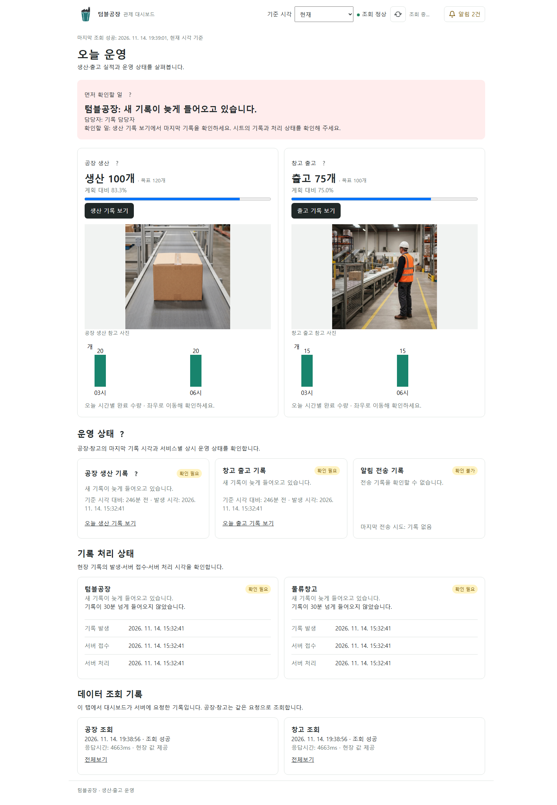
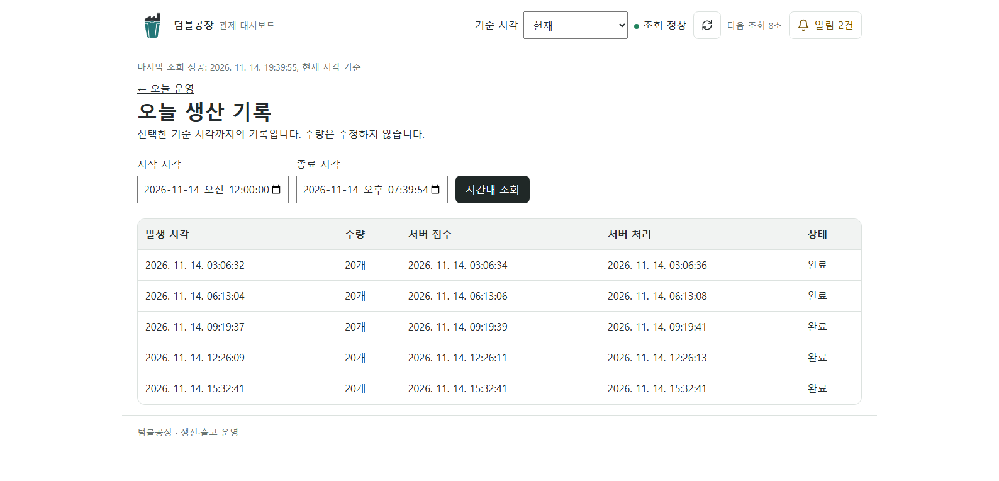

# 5회차: Google 시트와 Apps Script

> AI 도구에서 같은 프로젝트 폴더를 열고 프롬프트를 하나씩 보냅니다. 결과를 직접 확인한 뒤 다음으로 넘어갑니다. 오류가 나면 오류 문구를 그대로 보내 해결을 요청하세요. 화면은 예시와 달라도 됩니다.
>
> 실제 현장 정보 대신 수업용 자료를 사용합니다.

## 완성 예시





## 준비

4회차 프로젝트 폴더를 열고 서버를 켭니다.

## 따라하기

```text
내 Google 시트에 수업용 생산·출고 기록을 저장하고 Google Apps Script 웹앱으로 조회하게 만들어줘. API_CONTRACT.md의 현황과 기록 형식을 유지해줘.
```

```text
Google 로그인, Apps Script 프로젝트 생성과 배포를 도와줘. 로그인과 권한 승인은 내가 직접 할게. 이미 만든 프로젝트가 있으면 중복 생성하지 말고, 웹앱 접근 범위를 알려준 뒤 내가 확인하면 진행해줘.
```

```text
대시보드를 내 Apps Script 웹앱에 연결해줘. 강사 API와 내 서버 연결도 선택할 수 있게 유지하고 현재 연결 대상을 표시해줘.
```

## 직접 확인

- 시트에 수업용 기록을 넣고 대시보드의 수량을 확인합니다.
- 과거 조회와 연결 실패 안내도 확인합니다.
