# 6회차 목표: Discord 알림, 기록 처리, 트리거

## 6회차 완성 화면


생산·출고 현황, 기록 처리와 알림 전송 상태

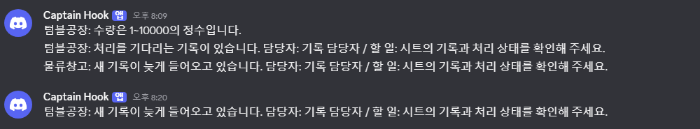

공장과 창고의 기록 지연 알림

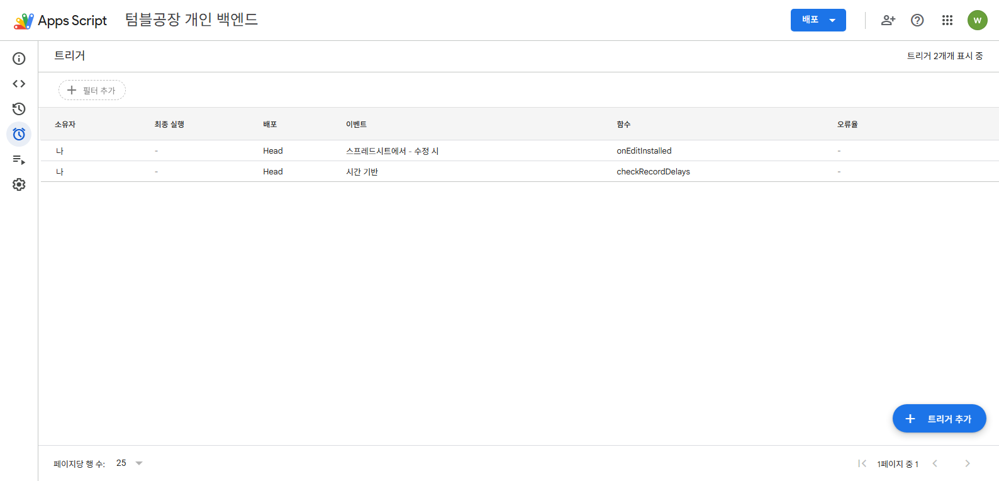

실습 중 등록된 시트 수정·시간 기반 트리거 (실습 종료 후 삭제)

Discord 알림, 시트 기록 처리, 트리거 (자동 실행)이 동작합니다.
내 Discord 시험 채널로 알림을 보냅니다. 화면의 알림 전송 기록 카드에는 "전송 성공"이 뜹니다. GAS 편집기에서 함수를 실행하거나 시트 칸을 고쳐 기록을 더하고 처리하면 화면 수량이 바뀝니다.
트리거 (자동 실행)은 두 개입니다. 하나는 시트를 고치면 바로 처리하고 다른 하나는 1분마다 기록이 늦게 들어오는 현장을 알립니다. 실습이 끝나면 두 트리거를 지웁니다.

## 시작 전에

5회차를 끝낸 `C:\ai-class\tumble-dashboard`에서 이어 합니다(완료 브랜치 `milestone-5`와 같은 출발점). 내 GAS 웹 앱이 배포돼 있습니다. 화면은 내 Google 시트 값으로 "조회 정상"이며 기록 화면도 열립니다.

준비물: 5회차에 쓴 개인 Google 계정으로 로그인한 ego 브라우저와 Discord 계정. Discord는 ego 브라우저에서 https://discord.com 으로 써도 됩니다. 명령 창과 화면 창(화면 서버가 켜진 창)도 준비합니다.

1. AI 도구로 `C:\ai-class\tumble-dashboard` 폴더를 열고 새 대화를 시작합니다.
2. 화면 창이 켜져 있으면 ego 브라우저에서 `http://127.0.0.1:4173`을 엽니다. 화면 창이 없으면 아래 6-1을 먼저 보냅니다. 답이 오면 AI 도구에 "화면 서버를 켜 주세요."라고 보낸 뒤 같은 주소를 엽니다. 이때는 6-2부터 이어 갑니다.
3. 아래 "수업 날 새 실습 시트 만들기"를 합니다.

이번 회차에 알아 둘 것은 아래와 같습니다.

- 이번 회차에 처음 나오는 말입니다.
  - **웹훅**: Discord 채널에 글을 보낼 때 사용하는 주소입니다. 이 주소로 글을 보내면 연결된 채널에 올라옵니다. Discord 화면에는 "웹후크"로 나옵니다.
  - **스크립트 속성**: GAS 프로젝트 설정에 이름과 값으로 저장해 두는 칸입니다. 웹훅 주소처럼 코드가 읽어 쓰는 값을 여기에 둡니다. 5회차에 만든 `SPREADSHEET_ID`, `TUMBLE_META`도 여기에 있습니다.
  - **트리거**: 정해 둔 때에 함수를 저절로 실행하는 설정입니다. 이번 회차에는 시트를 고칠 때와 1분마다 실행되는 트리거 두 개를 만듭니다.
- 새 대화를 열 때마다 6-1의 프롬프트를 먼저 보낸 뒤 하던 번호부터 이어 갑니다.
- GAS 편집기의 함수 실행과 스크립트 속성·트리거 메뉴 조작은 브라우저에서 합니다. 시트 수정과 Discord 설정도 브라우저에서 합니다. 직접 해도 되고, AI 도구에 ego 브라우저로 해 달라고 부탁해도 됩니다.
- 이번 회차 프롬프트는 GAS (Google 쪽 코드)에 함수를 하나씩 더합니다. 각 번호의 프롬프트는 내 컴퓨터의 파일만 고칩니다. Google에는 "올리고"가 붙은 번호(6-6, 6-11, 6-15)에서 올립니다. 올린 뒤에는 편집기 탭을 새로고침(F5)해야 새 함수가 함수 선택 목록에 보입니다. 함수 목록에는 왼쪽에서 선택한 파일의 함수가 나옵니다. 이번 회차 함수는 `Code.gs`를 누른 뒤 고릅니다. 함수 선택 상자는 눌러서 열어야 모든 함수가 보입니다. 닫힌 상자에는 지금 고른 함수 하나만 보입니다.
- 이번 회차 프롬프트는 웹 앱의 응답을 바꾸지 않아서 `gas:push`로 올리면 됩니다. 편집기 실행과 트리거는 `gas:push`로 올린 코드로 바로 실행됩니다. 웹 앱의 응답까지 바꿔 달라고 부탁했으면 5회차 맨 아래 "참고"의 상자를 보냅니다.
- 화면은 10초마다 다시 조회합니다. 시트가 바뀐 뒤 10~15초 기다리면 화면에 반영됩니다. 화면 서버는 켜 둔 채로 진행합니다. 화면 파일은 이번 회차에 바뀌지 않습니다.
- 이 회차는 따라잡기와 발표 시간도 겸합니다. 프롬프트는 짧고, 대부분은 편집기와 시트에서 확인합니다. 확인을 AI 도구에 부탁해도 됩니다.

### 수업 날 새 실습 시트 만들기

화면은 "오늘" 기록만 셉니다. 5회차에 만든 시트의 시드 기록은 그날 날짜라서 오늘 화면에는 기록이 없는 것으로 나옵니다. 오늘 날짜의 시드 기록이 담긴 새 시트를 만듭니다. 웹 앱은 다시 배포하지 않아도 새 시트를 읽습니다. AI 도구에 "수업 날 새 실습 시트를 만들어 주세요."라고 부탁해도 됩니다.

- 직접 하기: 명령 창에서 `cd C:\ai-class\tumble-dashboard`를 치고 `npm.cmd run gas:editor`로 편집기를 엽니다. 다른 브라우저에 열리거나 열리지 않으면 명령 창에 나온 편집기 주소를 ego 브라우저에서 엽니다.
- 직접 하기: 브라우저에 열린 편집기 오른쪽 위 계정이 5회차에 쓴 개인 Google 계정인지 봅니다. 왼쪽 파일 목록에서 `Setup.gs`를 누르고, 위쪽 함수 선택에서 `createTrainingSpreadsheet`를 골라 "실행"을 누릅니다.
- 완료 기준: 실행 로그에 `새 실습 시트: https://docs.google.com/spreadsheets/…`가 나옵니다. 10~15초 안에 화면이 바뀝니다. "생산 100개 · 목표 120개", "출고 75개 · 목표 100개"이고 "조회 정상"입니다.
- 직접 하기: 이 시트는 이번 회차 내내 씁니다. 실행 로그의 주소를 Ctrl+클릭해 새 탭으로 열어 두고, 편집기 탭도 열어 둡니다.

## 6-1. 지침 세팅

```text
[6-1] 이번 회차 문서를 이 프로젝트로 가져오기 위해, 수업 저장소(class)를 다시 받아 class/milestone-5의 AGENTS.md와 docs/guide를 git checkout class/milestone-5 -- AGENTS.md docs/guide 꼴로 이 프로젝트로 가져와 주세요(브랜치는 옮기지 않습니다).
그다음 AGENTS.md를 작업 지침으로 삼아 주세요. 프롬프트에 없는 상세 구현은 docs/guide의 회차 문서와 그 회차 완료 브랜치 코드(class/main)에서 확인합니다.
이번 번호에서는 AGENTS.md와 docs/guide의 회차 문서를 끝까지 읽고, 만드는 일은 다음 번호부터 합니다. 답 맨 앞에 "읽은 문서: session-1 ~ session-6" 꼴로 읽은 문서를 한 줄로 알려 주세요.
```

- 하는 일: 수업 저장소 `milestone-5`에서 규칙 파일과 보충 문서를 웹 서비스 폴더로 가져옵니다. AI 도구가 1~6회차 문서를 읽어 둡니다. `docs\guide`에 6회차 보충 문서가 새로 생깁니다.
- 목표: 이 번호를 다른 번호보다 먼저 보냅니다. 함수 이름, 알림 문장, 시트에 남기는 값은 6회차의 자세한 약속입니다. 이 약속이 6회차 보충 문서와 완료 브랜치 `main` 코드에 있기 때문입니다.
- 완료 기준: 파일 탐색기나 AI 도구의 파일 목록에서 `docs\guide`에 `session-6.md`가 생깁니다. 답 맨 앞이 "읽은 문서: session-1 ~ session-6"입니다.

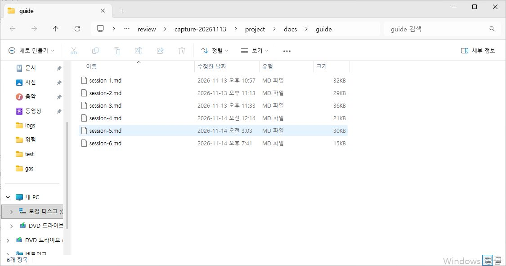

6-1 6회차까지 준비된 보충 문서 폴더

## 6-2. 한 번에 하나씩 실행되게

```text
[6-2] 시트에 쓰는 일이 겹치지 않도록, GAS (Google 쪽 코드)에 LockService (한 번에 하나씩만 실행되게 하는 잠금)을 추가해 주세요.
잠금 안에서 실행할 함수들은 뒤 번호에서 만듭니다.
자세한 내용은 docs/guide/session-6.md의 "잠금"을 참고해 주세요.
```

- 하는 일: `gas\Code.gs`에 `LockService` (동시에 실행되지 않도록 잠그는 서비스)를 추가합니다. 이 잠금은 시트에 값을 쓰는 함수가 한 번에 하나만 실행되게 합니다.
- 목표: 시트에 값을 쓰는 작업 두 개가 동시에 실행되면 같은 줄을 덮어쓸 수 있습니다. 이후 단계에서 만드는 알림 시험, 기록 처리, 자동 실행 함수는 이 잠금을 걸고 실행합니다.
- 완료 기준: AI 도구가 만들었다고 알려 줍니다. `notepad gas\Code.gs`로 열어 Ctrl+F로 `LockService`를 찾으면 보입니다. 아직 Google에 올리지 않았습니다.

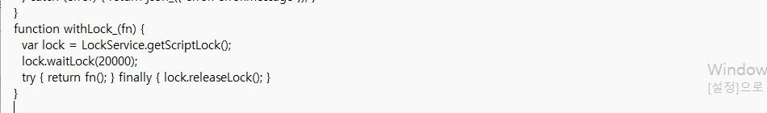

6-2 시트 작업 잠금 코드

## 6-3. Discord로 알림 보내기

```text
[6-3] 확인할 일을 내 Discord 시험 채널로 받기 위해, GAS (Google 쪽 코드)에 sendAlert_ (Discord로 알림을 보내는 기능)을 추가해 주세요.
보낸 결과를 시트에 남기는 일은 다음 번호에서 합니다.
자세한 내용은 docs/guide/session-6.md의 "Discord 알림 보내기"와 "현장 이름 붙이기"를 참고해 주세요.
```

- 하는 일: `gas\Code.gs`에 스크립트 속성의 웹훅 주소(`DISCORD_WEBHOOK_URL`)로 Discord에 알림을 보내는 기능이 생깁니다.
- 목표: 확인할 일을 Discord 채널에서 바로 받게 합니다. 보낼 글 앞에 현장 이름을 한 번만 붙입니다. 웹훅 주소와 전송 중 발생한 오류 내용은 로그와 시트에 남기지 않습니다. 알림이 가지 않아 원인을 찾을 때는 AI 도구에 오류 내용을 로그에 남겨 달라고 해도 됩니다.
- 완료 기준: `gas\Code.gs`에서 `DISCORD_WEBHOOK_URL`과 `물류창고`를 찾으면 보입니다. 이름이 한 번만 붙는지는 6-6과 6-17에서 Discord로 봅니다.

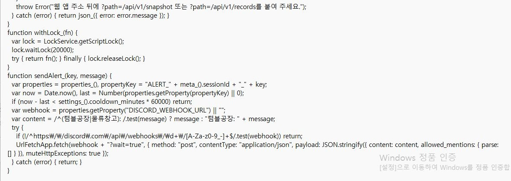

6-3 Discord 알림 전송 코드

## 6-4. 보낸 결과 남기기와 testDiscordAlert (알림 시험 함수)

```text
[6-4] 알림이 갔는지 화면의 "알림 전송 기록" 카드에서 보기 위해, GAS (Google 쪽 코드)에 보낸 결과를 알림 기록 탭에 남기는 일과 testDiscordAlert (알림 시험 함수)를 추가해 주세요.
이번 번호에서는 GAS (Google 쪽 코드)만 고칩니다.
자세한 내용은 docs/guide/session-6.md의 "보낸 결과 남기기"와 "알림 시험 함수"를 참고해 주세요.
```

- 하는 일: `gas\Code.gs`에 알림을 보낸 결과를 알림 기록 탭에 한 줄씩 남기는 기능이 생깁니다. 편집기에서 실행할 `testDiscordAlert` (알림 시험 함수)도 생깁니다.
- 목표: 화면의 알림 전송 기록 카드는 알림 기록 탭의 마지막 행을 읽습니다. 그래서 화면 코드를 고치지 않아도 알림을 보낸 결과가 화면에 나옵니다.
- 완료 기준: `gas\Code.gs`에서 `testDiscordAlert`와 "알림 연결 테스트입니다."를 찾으면 보입니다. 이 함수는 6-6에서 편집기 함수 목록에서 고릅니다.

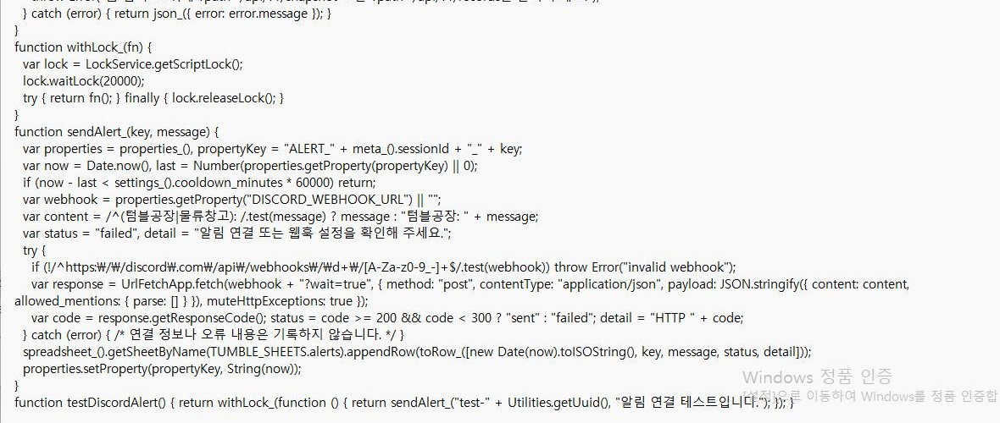

6-4 알림 전송 결과 기록과 시험 함수

## 6-5. Discord 웹훅 만들어 스크립트 속성에 넣기 (직접 하기)

1. Discord에서 내가 만든 Discord 서버의 채널 하나를 알림 받을 시험 채널로 고릅니다. Discord의 "서버"는 채널을 모아 둔 공간으로, 4회차의 내 서버와는 다릅니다. Discord 서버가 없으면 왼쪽 맨 아래 "+"(서버 추가하기), "직접 만들기"로 하나 만듭니다.
2. 채널 이름 옆 톱니바퀴(채널 편집), "연동", "웹후크", "새 웹후크"를 차례로 누릅니다. 새로 생긴 웹후크를 열고 "웹후크 URL 복사"를 누릅니다. 복사한 주소는 4에서 붙여 넣습니다.
3. GAS 편집기 왼쪽 톱니바퀴(프로젝트 설정)를 누르고 아래 "스크립트 속성"으로 내려갑니다.
4. "스크립트 속성 수정", "스크립트 속성 추가"를 누릅니다. 속성에 `DISCORD_WEBHOOK_URL`, 값에 복사한 웹훅 주소를 붙여 넣습니다. 그 뒤 "스크립트 속성 저장"을 누릅니다. 이미 있는 `SPREADSHEET_ID`, `TUMBLE_META`는 그대로 둡니다.

- 하는 일: Discord 시험 채널에 웹훅을 만듭니다. 그 주소를 GAS 프로젝트의 스크립트 속성 `DISCORD_WEBHOOK_URL`에 넣습니다.
- 목표: 6-3에서 만든 기능은 스크립트 속성 `DISCORD_WEBHOOK_URL`에 적힌 주소로 알림을 보냅니다. 그래서 웹훅 주소를 이 속성에 넣습니다.
- 완료 기준: 스크립트 속성 목록에 `DISCORD_WEBHOOK_URL`이 생겼습니다.

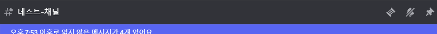

6-5 사용할 Discord 시험 채널

## 6-6. 올리고 시험 알림 보내기

```text
[6-6] 지금까지 만든 알림 기능을 편집기에서 실행할 수 있도록, npm 명령 gas:push를 한 번 실행하고 올린 파일 수만 알려 주세요.
웹 앱은 다시 배포하지 않습니다.
자세한 내용은 docs/guide/session-6.md의 "코드를 두는 곳과 올리는 법"을 참고해 주세요.
```

- 하는 일: AI 도구가 `gas:push`로 6-2 ~ 6-4의 코드를 Google에 올립니다. 그다음 편집기에서 시험 알림을 보냅니다.
- 목표: Discord에 알림이 도착한 뒤 알림 기록 탭에 결과가 남는지 확인합니다. 화면의 알림 전송 기록 카드에도 그 결과가 표시되는지 봅니다.
- 직접 하기: AI 답에 올린 파일이 5개라고 나오면 편집기 탭을 새로고침합니다. 왼쪽에서 `Code.gs`를 누르고 함수 선택에서 `testDiscordAlert`를 골라 "실행"을 누릅니다. 외부 서비스에 연결할 권한이 없다는 오류가 나오면 5회차 5-17(첫 권한 승인)에서 일부만 고른 것입니다. 다시 "실행"을 눌러 승인 창이 나오면 "모두 선택"으로 승인합니다.
- 완료 기준: 시험 채널에 "텀블공장: 알림 연결 테스트입니다."가 옵니다. 시트 알림 기록 탭에는 사건 ID가 `test-`로 시작하는 한 줄이 생깁니다. 발송 상태는 `sent`, 상세는 `HTTP 200`입니다. 10~15초 안에 화면의 운영 상태 알림 전송 기록 카드가 바뀝니다. "전송 성공", "알림 전송이 완료됐습니다."가 표시됩니다.
- 알아 두기: 스크립트 속성에 `ALERT_`로 시작하는 속성이 하나 생깁니다. 같은 알림을 일정 시간 안에 다시 보내지 않도록 전송 시각을 저장해 둔 것입니다. 그대로 두면 됩니다.

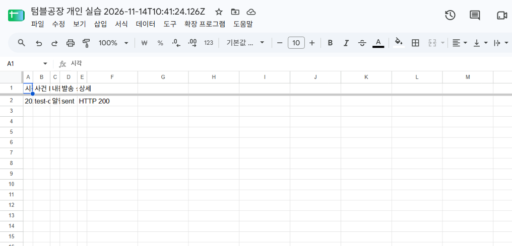

6-6 알림 기록에 남은 sent 및 HTTP 200

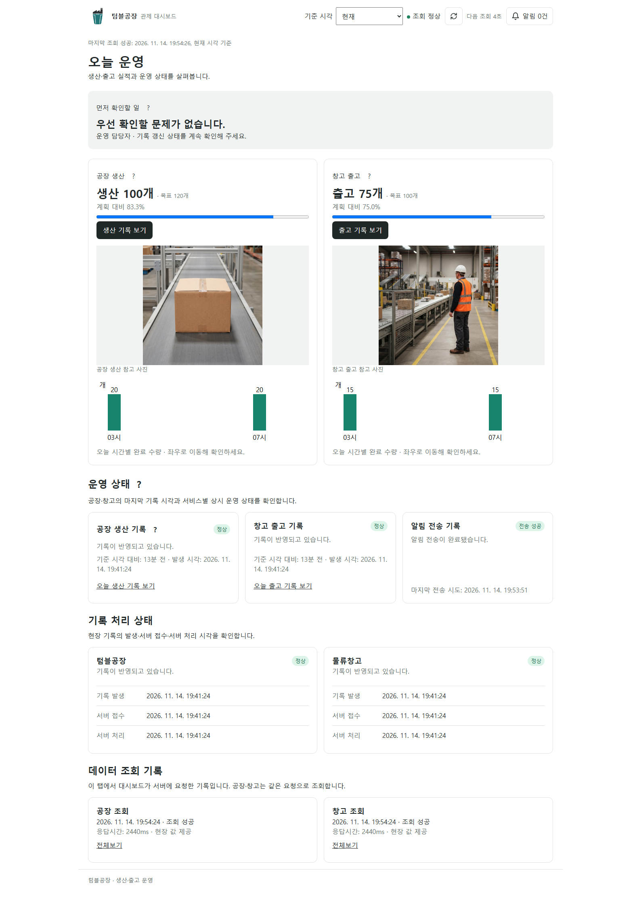

6-6 화면의 알림 전송 성공


6-6 Discord 시험 채널에 도착한 알림

## 6-7. 설정 이력 남기기

```text
[6-7] 화면이 기록을 처리한 때의 설정을 읽도록, GAS (Google 쪽 코드)에 rememberSettings_ (현재 설정을 이력 끝에 더하는 기능)을 추가해 주세요.
이 기능을 부르는 함수는 뒤 번호에서 만듭니다.
자세한 내용은 docs/guide/session-6.md의 "설정 이력"을 참고해 주세요.
```

- 하는 일: 화면은 설정 탭을 바로 읽지 않고, 설정 탭 A1 칸의 메모(설정 이력)를 읽습니다. 이 번호에서는 `gas\Code.gs`에 설정 탭의 지금 값을 그 이력 끝에 더하는 함수(`rememberSettings_`)가 생깁니다.
- 목표: 설정 탭에서 고친 값은 설정 이력에 추가돼야 화면에 반영됩니다. 기록을 처리할 때마다 그때의 설정이 이력에 남습니다. 이 함수는 기록을 처리하는 6-10의 두 함수와 6-12의 자동 실행 함수에서 부릅니다.
- 완료 기준: AI 도구가 만들었다고 알려 줍니다. `gas\Code.gs`에서 `rememberSettings_`를 찾으면 보입니다.

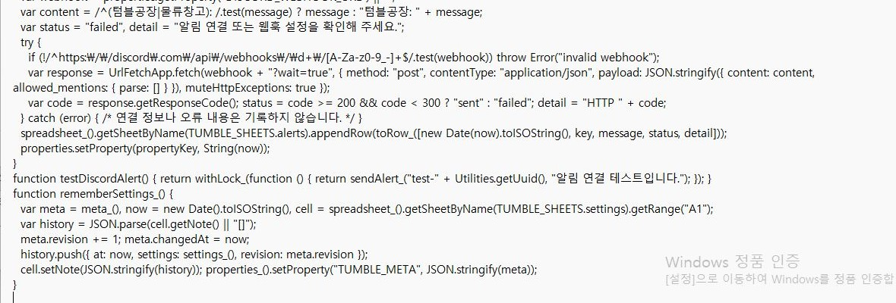

6-7 설정 이력 저장 함수

## 6-8. 한 줄 처리하기 1: 원본 지키기와 입력 검사

```text
[6-8] 시트에서 고친 접수 기록이나 틀린 값이 화면에 들어가지 않도록, GAS (Google 쪽 코드)에 processRow_ (기록 한 줄을 처리하는 함수)의 앞부분과 입력 검사를 추가해 주세요.
접수 시각과 처리 시각을 채우는 끝부분은 다음 번호에서 만듭니다.
자세한 내용은 docs/guide/session-6.md의 "한 줄 처리 앞부분"과 "한 줄 처리 입력 검사"를 참고해 주세요.
```

- 하는 일: `gas\Code.gs`에 기록 탭 한 줄을 처리하는 함수(`processRow_`)의 앞부분과 입력 검사가 생깁니다. 기록 줄의 A칸 메모에는 접수한 기록의 원본이 들어 있습니다.
- 목표: 접수한 기록은 시트에서 고쳐도 원본 값을 사용합니다. 입력 검사에서 규칙에 맞지 않는 값이 발견되면 "입력 확인 필요" 상태로 처리를 멈춥니다. 검사를 통과한 값만 6-9에서 만들 함수의 끝부분으로 넘깁니다.
- 완료 기준: `gas\Code.gs`에서 `processRow_`와 "입력 확인 필요"를 찾으면 보입니다.

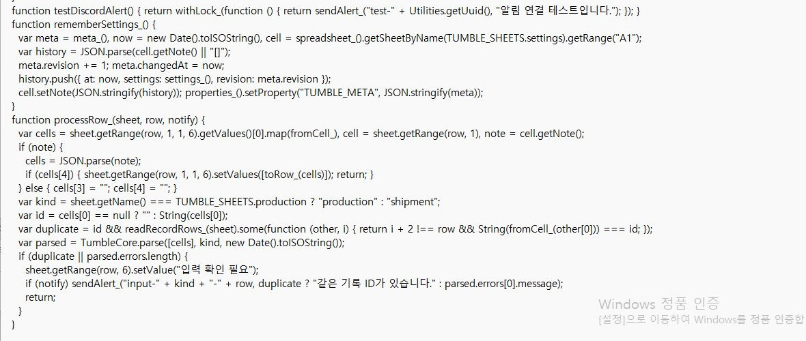

6-8 원본 기록과 입력 검사 코드

## 6-9. 한 줄 처리하기 2: 접수와 처리

```text
[6-9] 기록을 받은 때와 처리한 때를 남기기 위해, processRow_ (한 줄 처리 기능)에 접수 시각과 처리 시각을 채우는 끝부분을 추가해 주세요.
한 줄 처리를 부르는 함수는 다음 번호에서 만듭니다.
자세한 내용은 docs/guide/session-6.md의 "한 줄 처리 끝부분"을 참고해 주세요.
```

- 하는 일: 한 줄 처리 함수에 끝부분이 더해집니다. 접수 시각이 비어 있으면 현재 시각을 넣습니다. 처리 시각과 처리 상태 "완료"도 기록합니다. 그 현장의 처리 정지(`factory_paused`·`warehouse_paused`)가 `true`면 처리 시각을 비우고 "처리 대기"로 둡니다.
- 목표: 기록을 받은 때와 처리한 때가 시트에 남습니다. 이 함수는 6-10의 두 함수와 6-12의 자동 실행 함수가 부릅니다.
- 완료 기준: `gas\Code.gs`에서 "처리 대기"를 찾으면 보입니다.

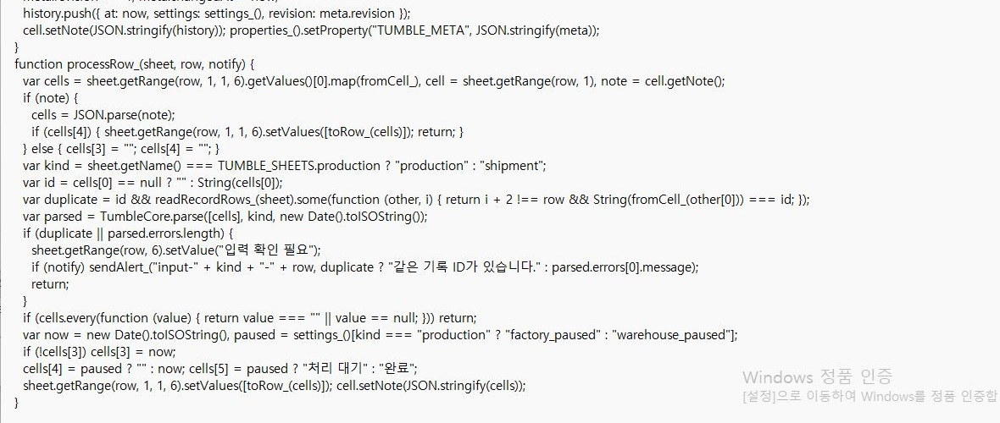

6-9 접수·처리 시각과 처리 상태 기록

## 6-10. 모든 기록 처리와 addDemoProductionRecord (데모 생산 기록 함수)

```text
[6-10] 편집기에서 기록을 더하고 처리해 볼 수 있도록, GAS (Google 쪽 코드)에 processPendingRecords (모든 기록 처리 함수)와 addDemoProductionRecord (데모 생산 기록 함수)를 추가해 주세요.
시트를 고칠 때 저절로 처리하는 일은 뒤 번호에서 만듭니다.
자세한 내용은 docs/guide/session-6.md의 "모든 기록 처리 함수"와 "데모 생산 기록 함수"를 참고해 주세요.
```

- 하는 일: `gas\Code.gs`에 두 기록 탭의 모든 줄을 처리하는 함수(`processPendingRecords`)가 생깁니다. 생산 기록 탭 끝에 기록 한 줄을 추가하고 바로 처리하는 함수(`addDemoProductionRecord`)도 생깁니다.
- 목표: 트리거 없이 편집기에서 함수를 실행합니다. 기록이 시트에 추가되고 처리된 뒤 화면 수량이 늘어나는 흐름을 확인합니다(6-11, 6-18).
- 완료 기준: `gas\Code.gs`에서 `processPendingRecords`와 `addDemoProductionRecord`를 찾으면 보입니다.

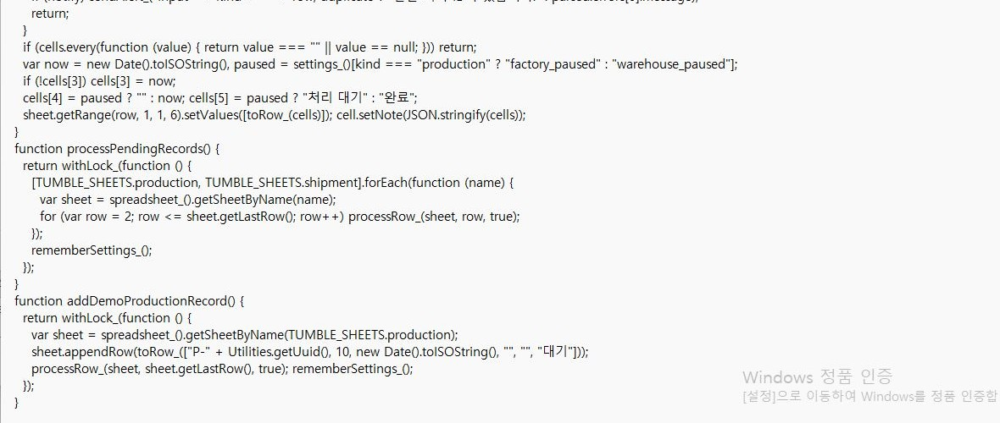

6-10 모든 기록 처리와 데모 생산 기록 함수

## 6-11. 올리고 데모 기록 더하기

```text
[6-11] 기록 처리 함수를 편집기에서 실행할 수 있도록, npm 명령 gas:push를 한 번 실행하고 올린 파일 수만 알려 주세요.
웹 앱은 다시 배포하지 않습니다.
자세한 내용은 docs/guide/session-6.md의 "코드를 두는 곳과 올리는 법"을 참고해 주세요.
```

- 하는 일: AI 도구가 `gas:push`로 6-7 ~ 6-10의 코드를 올립니다. 그다음 편집기에서 데모 생산 기록을 더합니다.
- 목표: 시트에 더한 기록이 처리되어 10~15초 안에 화면 수량까지 바뀌는지 봅니다.
- 직접 하기: AI 답에 올린 파일이 5개라고 나오면 편집기 탭을 새로고침합니다. `Code.gs`에서 `addDemoProductionRecord`를 골라 실행합니다.
- 완료 기준: 생산 기록 탭 끝에 `P-`로 시작하는 줄 하나(수량 10, 처리 상태 "완료")가 더해집니다. 시각 칸은 날짜 형식으로 바뀌지 않고 원래 글자 그대로 보입니다. 10~15초 안에 화면이 "생산 110개 · 목표 120개"가 됩니다.

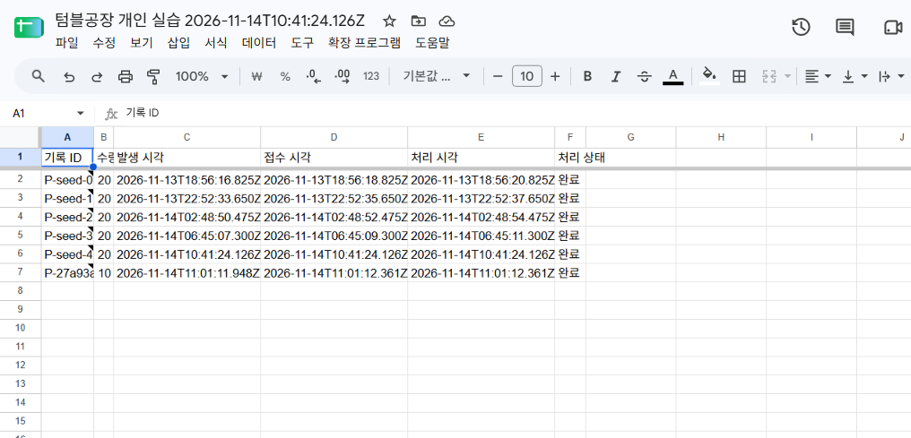

6-11 추가된 생산 기록

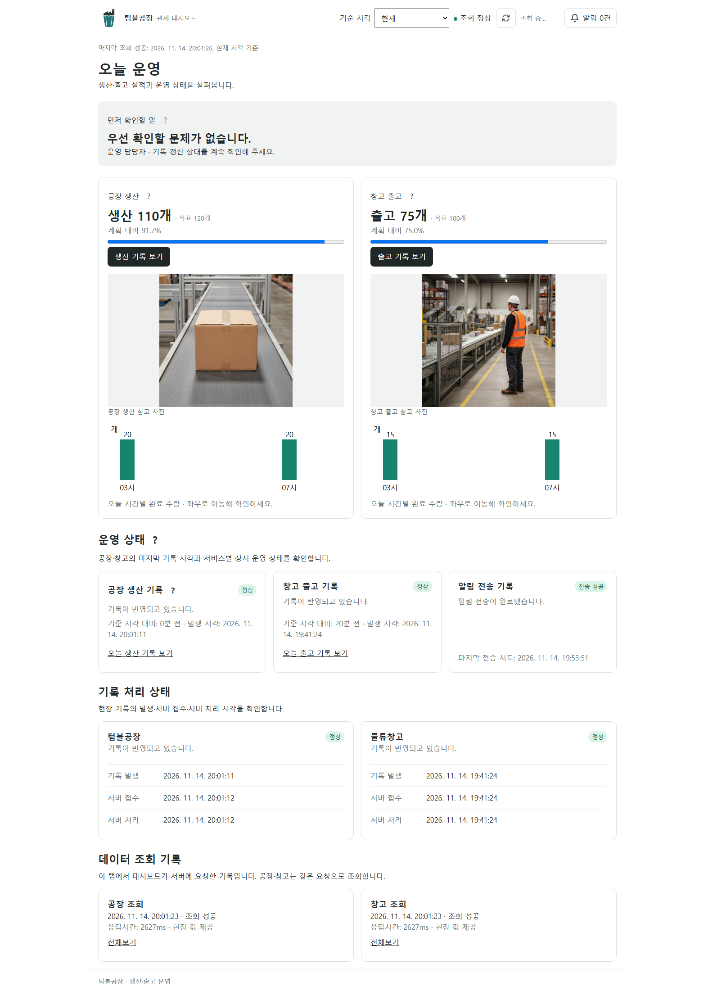

6-11 생산 110개가 표시된 화면

## 6-12. 시트를 고치면 바로 처리하는 함수

```text
[6-12] 시트를 고치는 순간 기록이 처리되도록, GAS (Google 쪽 코드)에 onEditInstalled (수정한 기록을 처리하는 트리거 함수)를 추가해 주세요.
트리거 (자동 실행)를 설치하는 일은 뒤 번호에서 합니다.
자세한 내용은 docs/guide/session-6.md의 "시트를 고치면 처리하는 함수"를 참고해 주세요.
```

- 하는 일: 편집기에서 함수를 선택해 실행하던 작업을 시트 수정 시 자동으로 처리하게 합니다. 이 번호에서는 `gas\Code.gs`에 `onEditInstalled` (시트를 수정하면 실행되는 함수)가 생깁니다.
- 목표: 시트 칸에 입력한 기록이 몇 초 안에 처리되게 합니다. 설정 탭을 고치면 수정한 값을 설정 이력에 추가합니다. 이 함수를 부르는 트리거 (자동 실행)은 6-14와 6-15에서 만듭니다.
- 완료 기준: `gas\Code.gs`에서 `onEditInstalled`를 찾으면 보입니다. 이 함수는 6-15 뒤 트리거 목록에 보입니다.

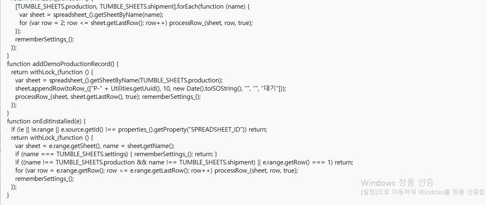

6-12 시트 편집 자동 처리 함수

## 6-13. 늦은 기록을 알리는 함수

```text
[6-13] 기록이 늦게 들어오는 것을 바로 알도록, GAS (Google 쪽 코드)에 checkRecordDelays (확인할 일이 있으면 Discord로 알리는 트리거 함수)를 추가해 주세요.
트리거 (자동 실행)를 설치하는 일은 다음 번호에서 합니다.
자세한 내용은 docs/guide/session-6.md의 "늦은 기록을 알리는 함수"를 참고해 주세요.
```

- 하는 일: `gas\Code.gs`에 `checkRecordDelays` (확인할 일이 있으면 Discord로 알리는 자동 실행용 함수)가 생깁니다.
- 목표: 트리거로 1분마다 실행되어 기록이 늦게 들어오는 현장을 바로 알립니다. 같은 알림은 설정 탭 `cooldown_minutes`(10분) 안에는 다시 보내지 않습니다.
- 완료 기준: `gas\Code.gs`에서 `checkRecordDelays`를 찾으면 보입니다. 이 함수는 6-15 뒤 트리거 목록에 보입니다.

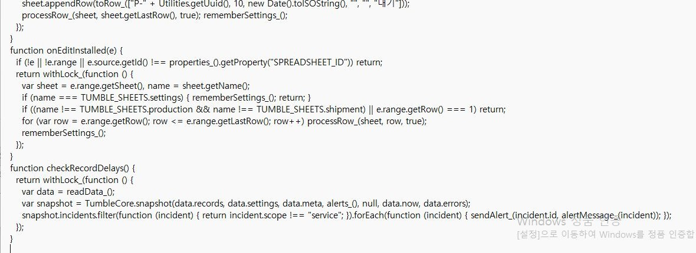

6-13 늦은 기록을 알리는 함수

## 6-14. 자동 실행 설치 함수

```text
[6-14] 앞에서 만든 두 함수가 저절로 실행되도록, GAS (Google 쪽 코드)에 installTrainingTriggers (두 함수의 트리거를 설치하는 함수)를 추가해 주세요.
자세한 내용은 docs/guide/session-6.md의 "자동 실행 설치 함수"를 참고해 주세요.
```

- 하는 일: `gas\Code.gs`에 6-12와 6-13의 두 함수를 자동으로 실행하도록 트리거를 설치하는 함수(`installTrainingTriggers`)가 생깁니다.
- 목표: 트리거는 6-15에서 편집기로 이 함수를 실행해 설치합니다. 설치 함수를 실행할 때마다 두 함수의 예전 트리거를 지우고 새로 만듭니다. 그래서 트리거가 중복으로 설치되지 않습니다.
- 완료 기준: `gas\Code.gs`에서 `installTrainingTriggers`를 찾으면 보입니다.

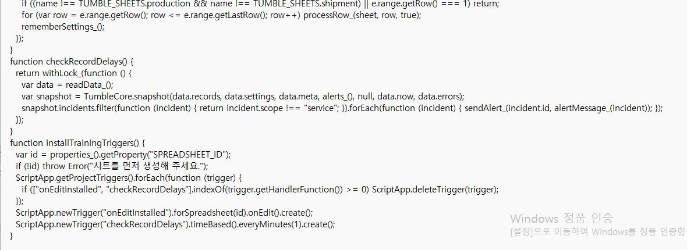

6-14 자동 실행 설치 함수

## 6-15. 올리고 트리거 설치

```text
[6-15] 자동 실행 함수를 편집기에서 설치할 수 있도록, npm 명령 gas:push를 한 번 실행하고 올린 파일 수만 알려 주세요.
웹 앱은 다시 배포하지 않습니다.
자세한 내용은 docs/guide/session-6.md의 "코드를 두는 곳과 올리는 법"을 참고해 주세요.
```

- 하는 일: AI 도구가 `gas:push`로 6-12 ~ 6-14의 코드를 올립니다. 그다음 편집기에서 트리거를 설치한 뒤 트리거 목록을 엽니다.
- 목표: 6-16과 6-17에서 두 자동 실행을 시험하려면 트리거가 먼저 설치돼 있어야 합니다.
- 직접 하기: AI 답에 올린 파일이 5개라고 나오면 편집기 탭을 새로고침합니다. `Code.gs`에서 `installTrainingTriggers`를 골라 실행합니다. 새 승인 창이 나오면 "모두 선택"으로 승인합니다. 그다음 편집기 왼쪽 트리거(시계 모양) 메뉴를 엽니다.
- 완료 기준: 트리거 목록에 두 줄이 있습니다. `onEditInstalled`(스프레드시트에서, 수정 시)와 `checkRecordDelays`(시간 기반)입니다. 목록에는 "시간 기반"으로만 보이고 1분 간격은 나오지 않습니다. `installTrainingTriggers`를 한 번 더 실행해도 두 줄만 남습니다.
- 알아 두기: 새 시트를 만든 지 30분이 넘었으면 1~2분 안에 시험 채널에 알림이 올 수 있습니다. 알림 내용은 "새 기록이 늦게 들어오고 있습니다."입니다. 정상입니다(6-17에서 봅니다).


6-15 두 개만 남은 자동 실행 목록

## 6-16. 시트를 고치면 바로 처리되는지 확인 (직접 하기)

1. 생산 기록 탭 빈 줄의 A칸에 `P-hand-1`, B칸에 수량 `5`를 씁니다. C칸(발생 시각)에는 바로 위 줄의 C칸만 복사해 붙여 넣습니다. **A칸은 복사하지 않습니다.** A칸에는 원본 메모가 들어 있어 복사하면 메모까지 함께 옮겨집니다.
   - 알아 두기: 칸을 하나씩 채우는 동안 처리 상태가 "입력 확인 필요"가 됩니다. 시험 채널에 "텀블공장: 수량은 1~10000의 정수입니다." 같은 입력 알림이 한 번 갈 수 있습니다. 세 칸을 다 채우면 "완료"로 바뀝니다.
2. `P-seed-0`의 수량을 25로 바꿉니다.
3. 설정 탭 `factory_target`을 `150`으로 바꿉니다.
   - 알아 두기: 설정 값에 범위를 벗어난 값(예: 목표에 글자)을 쓰면 화면이 바뀌지 않습니다. 편집기 왼쪽 실행 메뉴에서 `onEditInstalled`의 오류 문구를 봅니다. 예를 들어 "목표는 양의 정수 또는 빈칸입니다."를 보고 값을 고칩니다. AI 도구에 "onEditInstalled 오류를 보고 설정 값을 고쳐 주세요."라고 부탁해도 됩니다.
4. 3의 화면을 확인했으면 `factory_target`을 `120`으로 되돌립니다.

- 하는 일: 생산 기록 탭 칸에 기록을 써 넣고, 접수한 기록의 수량과 설정 탭의 목표를 바꿔 봅니다.
- 목표: 시트를 수정했을 때 트리거가 새 기록을 처리하는지 확인합니다. 이미 접수한 기록은 원본으로 되돌리는지 봅니다. 설정을 바꾸면 화면에도 반영되는지 확인합니다.
- 완료 기준:
  - 1에서: 세 칸을 다 채우고 몇 초 안에 접수·처리 시각이 채워지고 처리 상태가 "완료"가 됩니다.
  - 2에서: 몇 초 안에 20으로 돌아옵니다. 접수한 기록은 시트에서 고쳐도 원본으로 돌아갑니다.
  - 3에서: 10~15초 안에 화면이 "목표 150개"가 됩니다.

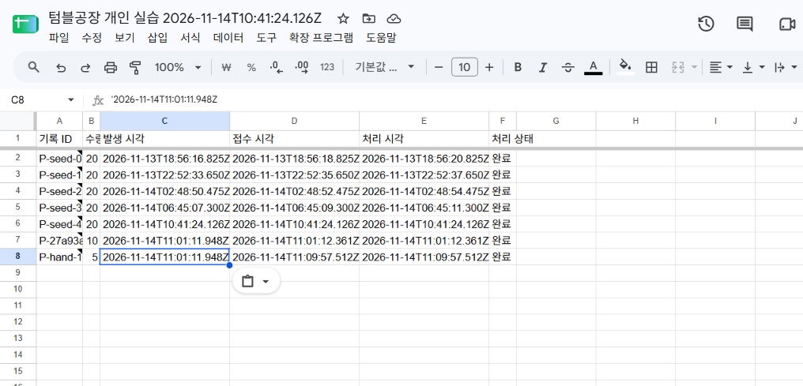

6-16 시트 칸에 써 넣은 기록이 완료된 상태

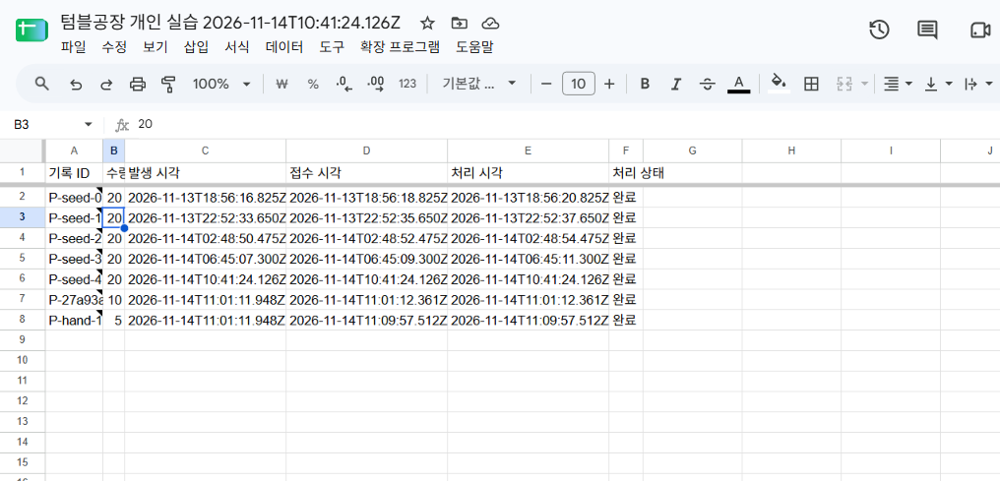

6-16 원래 수량으로 돌아온 접수 기록

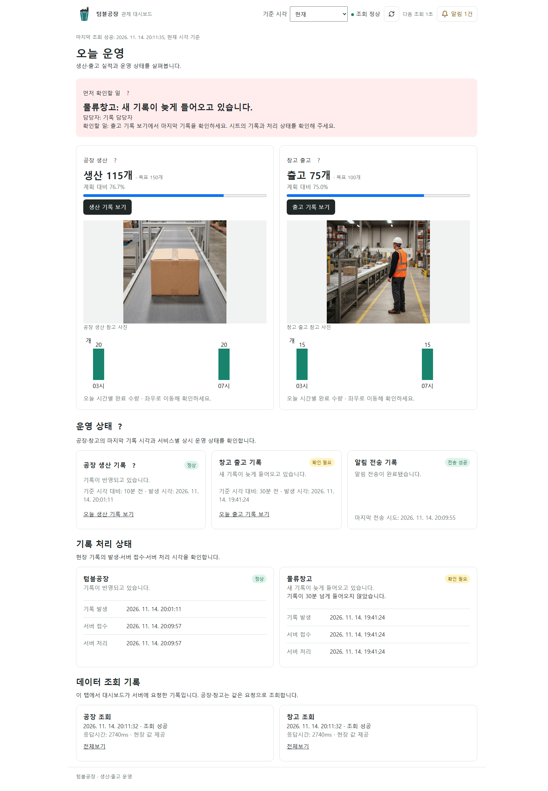

6-16 목표 150개가 반영된 화면

## 6-17. 늦은 기록 자동 알림 확인 (직접 하기)

1. 설정 탭 `delay_minutes`를 `1`로 바꾸고 1~2분 기다립니다.
   - 알아 두기: 같은 알림은 10분(`cooldown_minutes`) 안에는 다시 오지 않습니다.
2. 두 알림을 캡처해 둡니다. AI 도구에 ego 브라우저로 캡처해 달라고 해도 됩니다. 메일 주소가 보이면 가려 두는 것이 좋습니다. 편집기 왼쪽 실행 메뉴를 열어 `checkRecordDelays`가 1분 간격으로, `onEditInstalled`가 시트를 고칠 때마다 실행된 줄이 보이는지 봅니다.
3. `delay_minutes`를 `30`으로 되돌립니다.

- 하는 일: 설정 탭의 `delay_minutes`를 `1`로 바꿔 늦은 기록 알림이 오게 합니다. 실행 메뉴에서 두 트리거가 실행된 기록을 봅니다.
- 목표: 1분마다 실행되는 트리거가 늦은 기록을 Discord로 알리는지 봅니다. 현장 이름이 한 번만 붙는지도 확인합니다. 여기서 받은 알림은 6-18 발표에 씁니다.
- 완료 기준:
  - 1에서: 화면 두 현장이 "새 기록이 늦게 들어오고 있습니다."가 됩니다. 시험 채널에 아래 두 알림이 옵니다. 알림 기록 탭에는 사건 ID `FACTORY-FEED`, `WAREHOUSE-FEED`로 남습니다.
    - "텀블공장: 새 기록이 늦게 들어오고 있습니다. 담당자: 기록 담당자 / 할 일: 시트의 기록과 처리 상태를 확인해 주세요."
    - "물류창고: 새 기록이 늦게 들어오고 있습니다. 담당자: 기록 담당자 / 할 일: 시트의 기록과 처리 상태를 확인해 주세요."
  - 1에서: 앞에 "텀블공장: 텀블공장: "이나 "텀블공장: 물류창고: "처럼 이름이 두 번 붙지 않습니다.
- 막히면: 1에서 알림이 하나만 오고 알림 기록 탭에 발송 상태 `failed`, 상세 `HTTP 429`인 줄이 생길 수 있습니다. 이 경우 Discord가 잠시 받지 않은 것입니다. 같은 알림은 10분 뒤 자동으로 다시 보내므로 `delay_minutes`를 `1`로 둔 채 10분쯤 기다립니다. 10분 뒤에도 오지 않으면 알림 기록 탭의 마지막 줄을 복사해 "이렇게 나와요. 고쳐 주세요."와 함께 AI 도구에 붙여 넣습니다.


6-17 Discord에 도착한 공장·창고 지연 알림

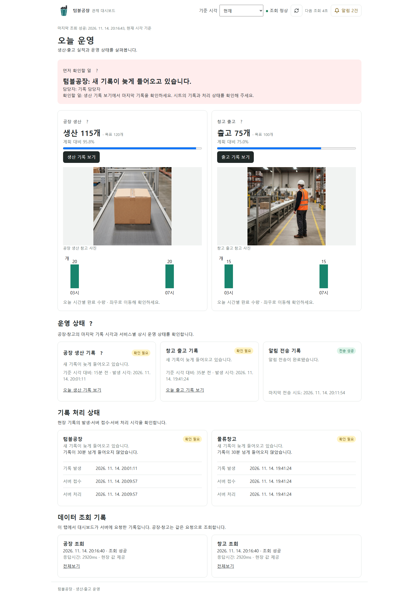

6-17 두 현장의 지연 안내

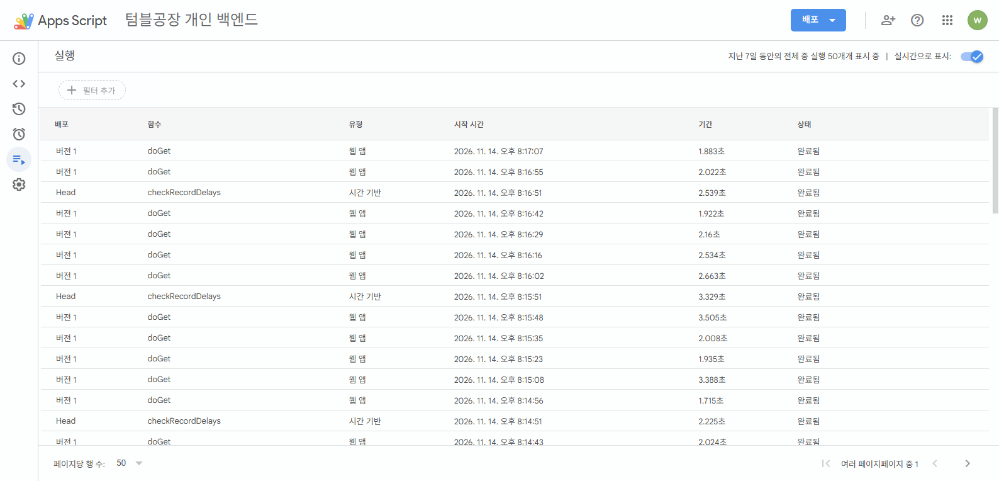

6-17 1분 간격으로 실행된 지연 확인 기록

## 6-18. 발표 준비 (직접 하기)

완성한 화면에서 아래 세 가지를 보여 줍니다. 캡처와 화면 공유에 메일 주소가 보이면 가려 두는 것이 좋습니다.

1. **내 시트 값으로 동작하는 화면**을 보여 줍니다. 오늘 운영 화면의 생산·출고 카드와 "조회 정상", 운영 상태 알림 전송 기록 카드의 "전송 성공"입니다.
2. **기록이 화면까지 오는 길**을 보여 줍니다. 편집기에서 `addDemoProductionRecord`를 실행하고 10~15초 뒤 생산 수량이 10 오르는 것입니다. 트리거를 지운 뒤에도 됩니다.
3. **자동 알림**을 보여 줍니다. 6-17에서 시험 채널에 온 두 알림(캡처)과 알림 기록 탭의 `FACTORY-FEED`, `WAREHOUSE-FEED` 줄입니다.

- 하는 일: 완성한 화면, 기록이 화면까지 오는 길, 자동 알림 세 가지를 보여 줄 준비를 합니다.
- 목표: 6회 동안 만든 것이 시트, 웹 앱, 화면, Discord로 이어져 동작합니다. 이 동작을 발표에서 보여 줍니다.
- 완료 기준: 세 가지를 모두 화면에서 보여 줄 수 있습니다.
- 덧붙일 이야기: 붙여 넣은 프롬프트 가운데 결과가 기대와 달랐던 것 하나를 이야기합니다. 그때 보낸 수정 요청도 함께 이야기합니다.

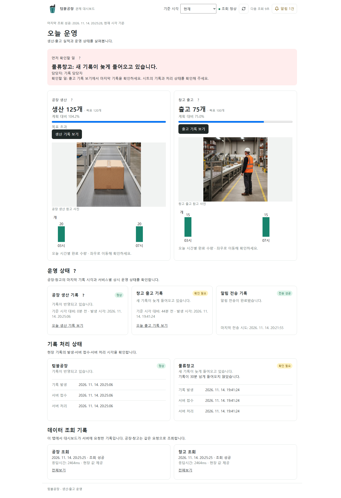

6-18 실습 실행 후 생산 125개, 출고 75개와 알림 전송 성공

## 6-19. 실습이 끝나면 트리거 지우기 (직접 하기)

발표 준비를 마친 뒤 마지막에 합니다.

1. 편집기 왼쪽 트리거(시계 모양) 메뉴를 엽니다. 두 줄 각각 오른쪽 점 세 개, "트리거 삭제", "완전삭제"를 누릅니다.

- 하는 일: 편집기의 트리거 메뉴에서 두 트리거를 지웁니다.
- 목표: 수업 뒤에도 트리거가 1분마다 실행되어 알림이 계속 오는 일을 막습니다.
- 완료 기준: 트리거 목록이 비었습니다.
- 알아 두기: 트리거를 남겨 두면 현장이 확인 필요인 동안 10분마다 알림이 옵니다. 무료 Google 계정은 트리거 실행 시간에 하루 한도가 있습니다.
- 알아 두기: 나중에 다시 쓰려면 `installTrainingTriggers`를 실행합니다. AI 도구에 "트리거를 다시 설치해 주세요."라고 부탁해도 됩니다. 새 실습 시트를 만든 뒤에도 다시 실행해야 합니다. 시트를 고칠 때 실행되는 트리거는 설치 당시의 시트에만 연결됩니다.

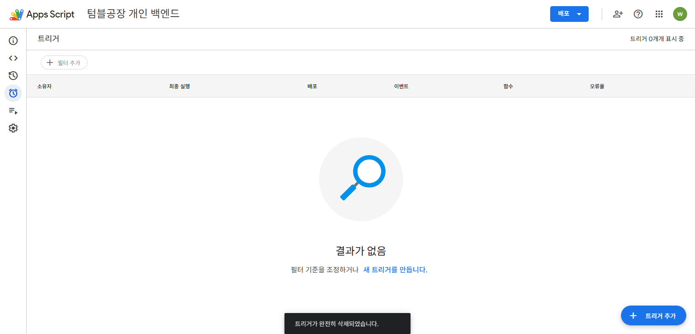

6-19 실습 종료 후 트리거 목록이 빈 화면

## 6회차 끝 확인

- [ ] 시험 채널에 "텀블공장: 알림 연결 테스트입니다."가 왔고, 알림 기록 탭에 `sent`·`HTTP 200` 줄이 있습니다.
- [ ] 화면 알림 전송 기록 카드가 "전송 성공", "알림 전송이 완료됐습니다."입니다.
- [ ] 웹훅 주소가 스크립트 속성 `DISCORD_WEBHOOK_URL`에 들어 있습니다.
- [ ] `addDemoProductionRecord`로 생산 수량이 10 오릅니다.
- [ ] 시트 칸에 써 넣은 기록이 몇 초 안에 "완료"가 됩니다. 접수한 기록의 수량을 바꾸면 원래 값으로 돌아옵니다.
- [ ] `delay_minutes`가 1이면 두 현장의 늦은 기록 알림이 1~2분 안에 옵니다.
- [ ] 실습 뒤 트리거 목록이 비어 있습니다.
- [ ] `public\config.js`의 주소가 6-1을 시작할 때와 같습니다.

이번 회차의 자세한 약속은 [6회차 보충 문서](../docs/guide/session-6.md)에 있습니다. 6회차가 따라하기의 마지막 회차입니다.
